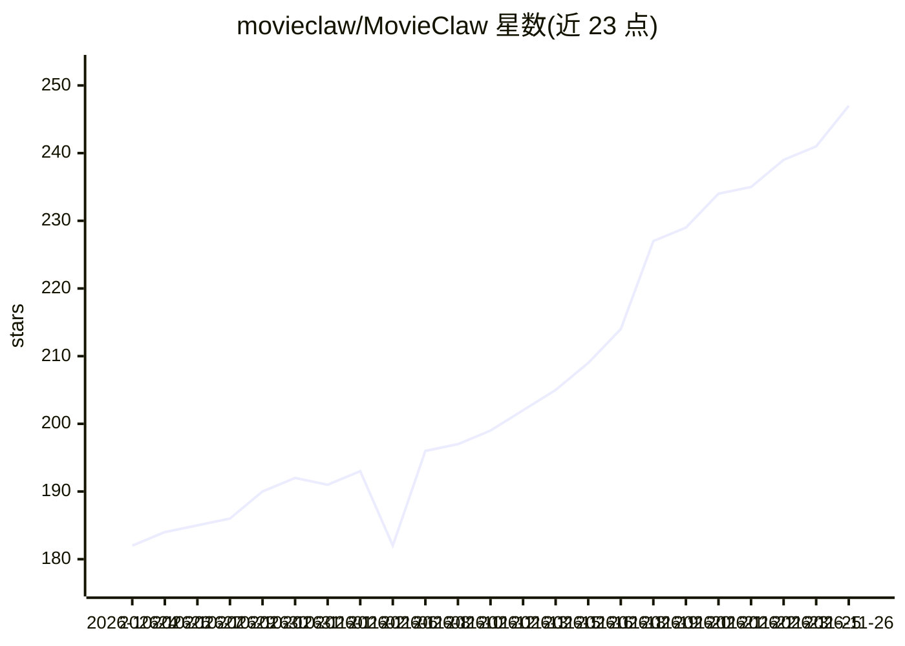

# movieclaw/MovieClaw

⭐ 247 · Python · NOASSERTION · 推送 2026-11-25 · [GitHub](https://github.com/movieclaw/MovieClaw) · [官网](https://movieclaw.io) · 组织维护 · 中文 README

**家庭媒体服务器：一个容器整合订阅下载与播放，内置 AI agent**

以单容器部署的个人媒体服务器，功能覆盖播放与海报墙、订阅与自动下载、索引器、字幕（含 PGS 转 SRT 与 AI 翻译）、元数据刮削（TMDB 与豆瓣双源）与家庭成员管理。内置自主 AI agent，可经微信/Telegram/Discord/飞书对话操作，也可通过 MCP 或 mclaw CLI 接入外部 agent；agent 需在设置中接入任意 OpenAI 兼容端点，跳过则其余功能仍可用。发布名解析使用蒸馏的小型 NER 模型，在 CPU 上约 3ms 解析一条。提供在线 demo（只读、每日重置）。

## 筛选速览

| 维度 | 判定 | 备注 |
|---|---|---|
| AI 角色 | `ai-enhanced` | 去掉 AI 部分产品仍成立 |
| 许可风险 | `none` | NOASSERTION |
| 部署形态 | `self-host` | docker 或自建部署 |
| 模型依赖 | local-ok | 支持本地模型 |
| 硬件要求 | — | 无带数字的原话,不猜 |
| 安装摩擦 | `low` | 无编译、无系统依赖或容器化 |
| 成熟度 | — | 结构信号不足 |

## 能力要点

- 单容器替代 Jellyfin/Sonarr/Radarr/Prowlarr/Bazarr/Jellyseerr 等多服务组合
- 内置 AI agent，支持微信/Telegram/Discord/飞书对话操作，工具调用过程可见
- 所有功能经 mclaw CLI 与 MCP 暴露，可接入 ChatGPT、Claude、Cursor 等
- 发布名解析用蒸馏 NER 模型，CPU 上约 3ms，歧义项进入待确认队列

## 适用场景

- 家庭 NAS 上统一管理影片订阅、下载、刮削与播放
- 通过微信对话让 agent 找片、订片、补字幕
- 接入 Infuse/VidHub 等第三方播放器并同步进度

## 场景标签

`聊天机器人` · 领域:对话与助手

## 证据(README 行号)

> L3:  One server replaces your entire media stack.
> L87: MovieClaw puts an autonomous, general-purpose AI agent inside your media server.
> L102: endpoint). Skip it and everything else still works. Teach it "skills" in plain Markdown:

## 星数曲线

2026-10-24 182 → 2026-11-26 247（+65）

---
*卡片 v1 · prompt 1.4 · 生成 2026-11-25 · 置信度 mid · 依据 README sha `24ae38b7e2d2` · [字段定义](../../DATASET.md)*
