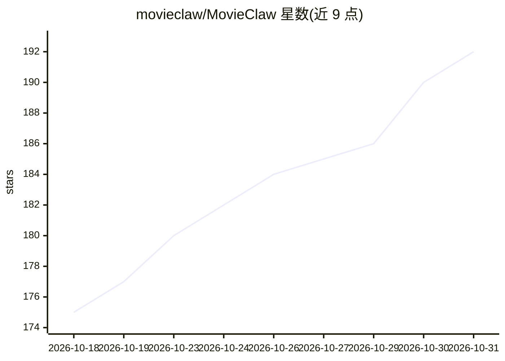

# movieclaw/MovieClaw

⭐ 192 · Python · NOASSERTION · 推送 2026-10-30 · [GitHub](https://github.com/movieclaw/MovieClaw) · [官网](https://movieclaw.io) · 组织维护 · 中文 README

**一体化家庭媒体服务器，内置 AI 代理替代 *arr 全家桶**

单容器部署的个人媒体服务器，功能覆盖播放（Web/手机/TV/Mac 原生应用，支持 4K HDR、杜比视界）、订阅自动追更下载、索引器、字幕（含 AI 翻译与 PGS 转 SRT）、刮削（TMDB/豆瓣双源）与家庭成员权限，替代 Sonarr/Radarr/Prowlarr/Bazarr/Jellyseerr/Jellyfin 多服务组合。内置通用 AI 代理（自然语言管理媒体库、制作/翻译字幕、设置升级规则），LLM 为可选接入（任意 OpenAI 兼容端点或自建 vLLM），不接 LLM 其余功能仍可用。另用小模型 NER（约 3ms/CPU）解析发布名，并通过 MCP 与 mclaw CLI 让 ChatGPT/Claude/Cursor 等外部代理调用全部功能。个人与家庭使用免费。

## 筛选速览

| 维度 | 判定 | 备注 |
|---|---|---|
| AI 角色 | `ai-enhanced` | 去掉 AI 部分产品仍成立 |
| 许可风险 | `none` | NOASSERTION |
| 部署形态 | `self-host` | docker 或自建部署 |
| 模型依赖 | local-ok | 支持本地模型 |
| 硬件要求 | — | 无带数字的原话,不猜 |
| 安装摩擦 | `low` | 无编译、无系统依赖或容器化 |
| 成熟度 | — | 结构信号不足 |

## 能力要点

- 单容器替代播放/订阅/索引/字幕/请求管理等多服务栈
- 自然语言 AI 代理：选片、制作翻译字幕、设置质量升级规则等
- MCP 与 mclaw CLI 暴露全部 API，可接 ChatGPT/Claude/Cursor
- 蒸馏小模型在 CPU 上约 3ms 解析发布名，含中文简写（国语中字）

## 适用场景

- 一台 NAS 上自建家庭影院并自动追更下载剧集
- 让 AI 代理用一句话完成订阅、升级、整理媒体库
- 用 Infuse 等第三方播放器继续观看并同步进度

## 场景标签

 · 领域:家庭媒体/自托管服务

## 证据(README 行号)

> L87: MovieClaw puts an autonomous, general-purpose AI agent inside your media server.
> L101: The agent needs an LLM connected under **Settings → Model Providers** (any OpenAI-compatible
> L102: endpoint). Skip it and everything else still works. Teach it "skills" in plain Markdown:

## 星数曲线

2026-10-18 175 → 2026-10-31 192（+17）

---
*卡片 v1 · prompt 1.4 · 生成 2026-10-22 · 置信度 mid · 依据 README sha `f42ebbe02568` · [字段定义](../../DATASET.md)*
