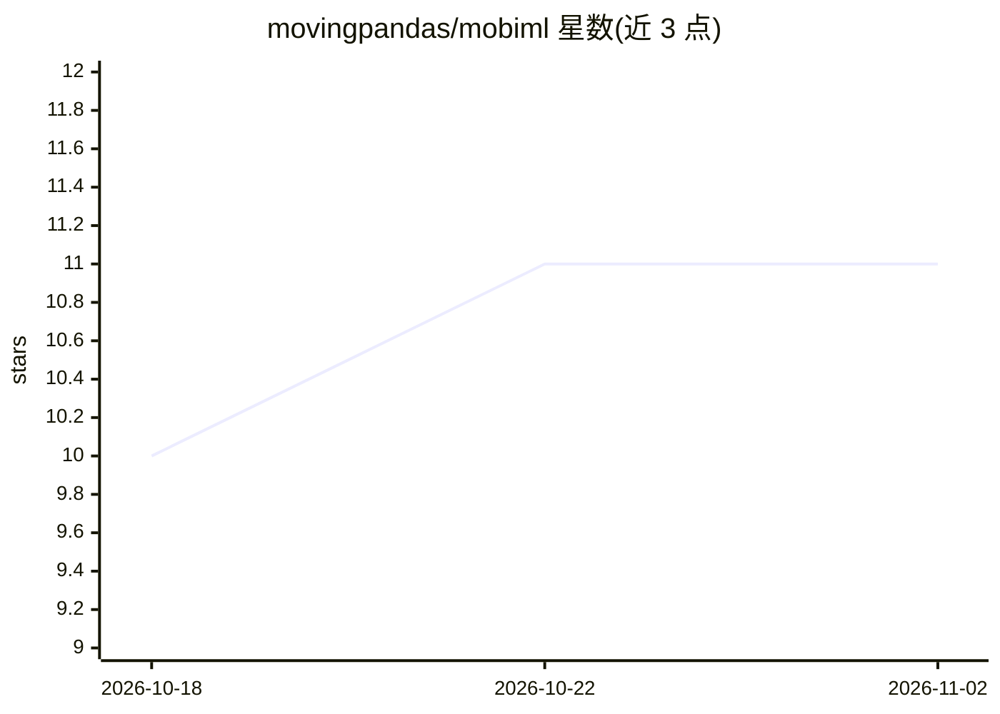

# movingpandas/mobiml

⭐ 11 · Python · BSD-3-Clause · 推送 2026-10-15 · [GitHub](https://github.com/movingpandas/mobiml) · [官网](https://movingpandas.github.io/mobiml/) · 组织维护

**轨迹数据的机器学习框架：预处理、采样、建模一站式工具**

MovingPandas 团队维护的 Python 机器学习框架，面向移动/轨迹数据的 ML 开发：包含数据集加载、预处理（输出 mobiml.Dataset）、时空感知采样、变换与模型模块。内置 GeoTrackNet 海事异常检测、Nautilus 船舶航线预测及联邦学习轨迹分类示例模型。开发受 GeoTorchAI 启发，依赖 pymeos，官方建议在 Linux 上使用；通过 uv 进行开发安装，配 examples 目录示例与模型文档模板推荐。

## 筛选速览

| 维度 | 判定 | 备注 |
|---|---|---|
| AI 角色 | `ai-native` | 本体是模型或模型工具 |
| 许可风险 | `permissive` | BSD-3-Clause |
| 部署形态 | `library` | 以包/库形式分发 |
| 模型依赖 | — | README 未给出锁定关系 |
| 硬件要求 | — | 无带数字的原话,不猜 |
| 安装摩擦 | `low` | 无编译、无系统依赖或容器化 |
| 成熟度 | — | 结构信号不足 |

## 能力要点

- datasets/preprocessing/samplers/transforms/models 五类模块组织轨迹 ML 流程
- 内置 GeoTrackNet（海事异常检测）、Nautilus（船舶航线预测）等模型
- 采样工具考虑轨迹的时空特性
- 配套模型文档（model card）模板推荐

## 适用场景

- 对 AIS 等轨迹数据做异常检测或航线预测
- 为轨迹 ML 开发做预处理与时空采样
- 在联邦学习设置下做轨迹分类实验

## 场景标签

`模型训练` · 领域:训练与推理

## 证据(README 行号)

> L12: **Framework for machine learning from movement data**
> L62: * `models`: This module contains models for a variety of mobility-related ML tasks.
> L73: * **GeoTrackNet -- Anomaly detection in maritime traffic patterns** based on https://github.com/CIA-Oceanix/GeoTrac

## 星数曲线

2026-10-18 10 → 2026-11-02 11（+1）

---
*卡片 v1 · prompt 1.4 · 生成 2026-11-02 · 置信度 high · 依据 README sha `3e91819f354c` · [字段定义](../../DATASET.md)*
