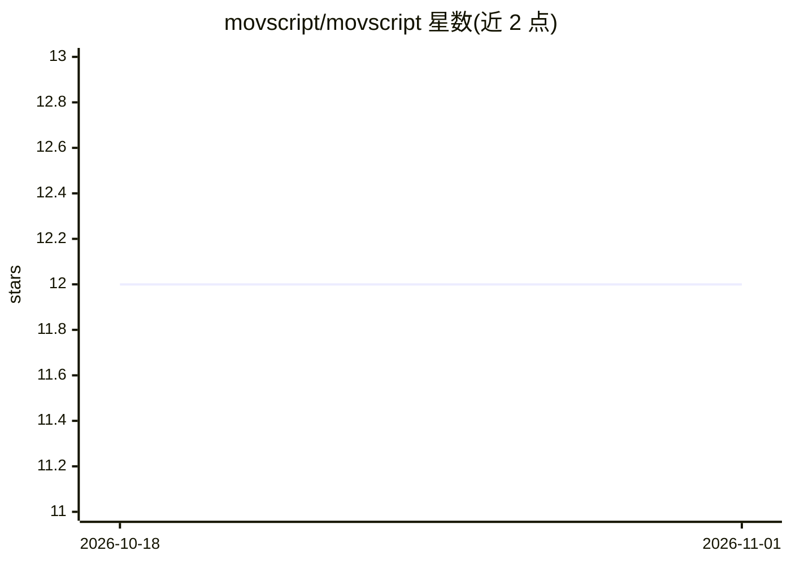

# movscript/movscript

⭐ 12 · TypeScript · Apache-2.0 · 推送 2026-07-06 · [GitHub](https://github.com/movscript/movscript) · [官网](https://movscript.github.io/movscript/) · 组织维护 · 中文 README

**AI 原生影视创作运行时：让生成模型协同完成视频生产**

Movscript 是围绕结构化项目格式构建的视频创作桌面应用：以剧本、参考素材与创作意图为输入，组织项目规划、分镜、镜头、生成任务、模型配置与粗剪组装等环节，并基于 Remotion 提供预览。它从描述运动的意图、节奏与结构出发，而非时间线和关键帧。可通过 Agent 插件从 Codex 等 Agent 供体调用而无需安装桌面端。分发目标覆盖 macOS（arm64/x64）、Windows x64 与 Linux AppImage；Docker 仅运行后端服务栈用于集成测试。README 自述仍处早期，格式与插件行为可能变动。

## 筛选速览

| 维度 | 判定 | 备注 |
|---|---|---|
| AI 角色 | `ai-native` | 本体是模型或模型工具 |
| 许可风险 | `permissive` | Apache-2.0 |
| 部署形态 | `desktop` | 安装包/桌面程序 |
| 模型依赖 | — | README 未给出锁定关系 |
| 硬件要求 | — | 无带数字的原话,不猜 |
| 安装摩擦 | `low` | 无编译、无系统依赖或容器化 |
| 成熟度 | `idea` | |

## 能力要点

- 以结构化项目格式组织剧本、分镜、生成任务与粗剪的桌面工作流
- Agent 插件可从 Codex 等 Agent 供体调用而无需安装桌面端
- 基于 Remotion 的预览工作台
- Docker Compose 运行后端服务栈（API/PostgreSQL/MinIO/Redis/Gitea）

## 适用场景

- 把剧本和参考素材组织成可规划、可预览的视频生产流程
- 通过 Codex 等 Agent 直接操作 Movscript 项目
- 搭建 Movscript 后端服务栈做集成与部署测试

## 场景标签

`视频生成` · 领域:内容生成

## 证据(README 行号)

> L18: Movscript helps creators turn scripts, references, and creative direction into a plannable, editable, previewable v
> L20: The public distribution currently focuses on desktop video creation workflows: project planning, scripts, assets, s
> L50: Install only the Movscript Agent Plugin when you want to use Movscript from Codex or another Agent provider without

## 星数曲线

2026-10-18 12 → 2026-11-01 12（+0）

---
*卡片 v1 · prompt 1.4 · 生成 2026-11-01 · 置信度 high · 依据 README sha `ac9df90cd3d5` · [字段定义](../../DATASET.md)*
