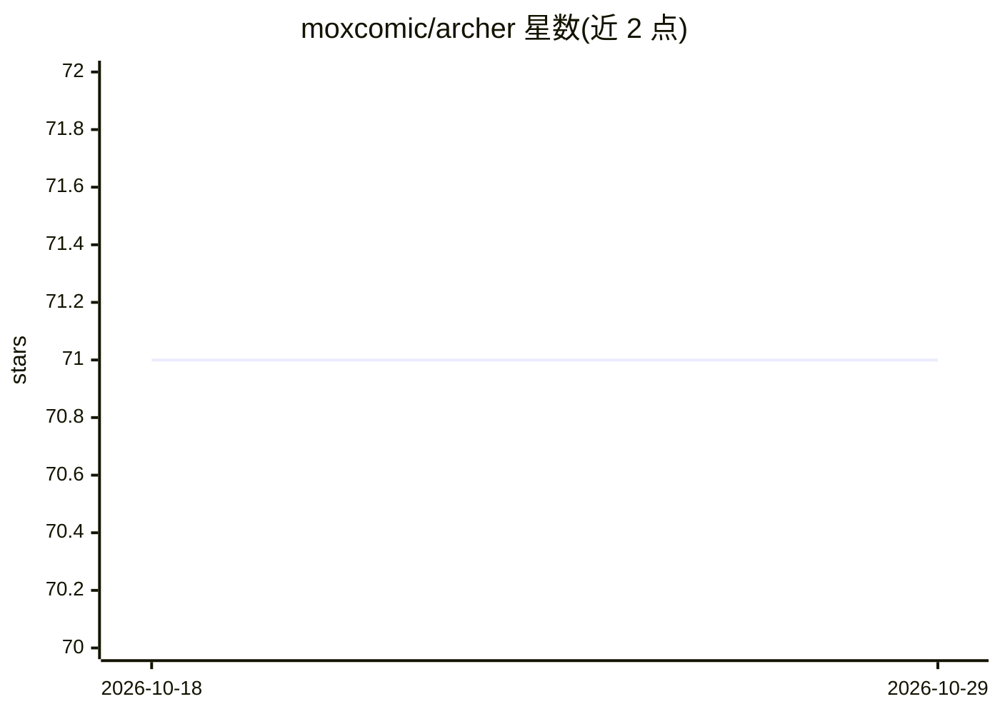

# moxcomic/archer

⭐ 71 · HTML · 推送 2026-08-29 · [GitHub](https://github.com/moxcomic/archer) · 个人维护

**麻将 AI 开发框架（README 仅含名称与文档链接）**

仓库自述为麻将 AI 开发框架，README 可见内容仅包含项目名称 Archer 与一个文档站点链接（https://moxcomic.github.io/archer/），未提供安装方法、功能说明、依赖列表或使用示例。README 可验证的信息不足以确认其具体能力、运行方式与适用对象，详细内容需查阅文档站点或代码仓库。

## 筛选速览

| 维度 | 判定 | 备注 |
|---|---|---|
| AI 角色 | `ai-ecosystem` | LLM/agent 周边工具 |
| 许可风险 | `none` | — |
| 部署形态 | `None` |  |
| 模型依赖 | — | README 未给出锁定关系 |
| 硬件要求 | — | 无带数字的原话,不猜 |
| 安装摩擦 | `low` | 无编译、无系统依赖或容器化 |
| 成熟度 | — | 结构信号不足 |

## 能力要点

- README 仅含项目名与文档站点链接
- 提供外部文档站点 https://moxcomic.github.io/archer/

## 适用场景

- 开发麻将 AI 相关功能时，经文档站点了解框架详情

## 场景标签

 · 领域:游戏/麻将 AI

## 证据(README 行号)

> L1: ## Archer

## 星数曲线

2026-10-18 71 → 2026-10-29 71（+0）

---
*卡片 v1 · prompt 1.4 · 生成 2026-10-24 · 置信度 low · 依据 README sha `e63695254266` · [字段定义](../../DATASET.md)*
