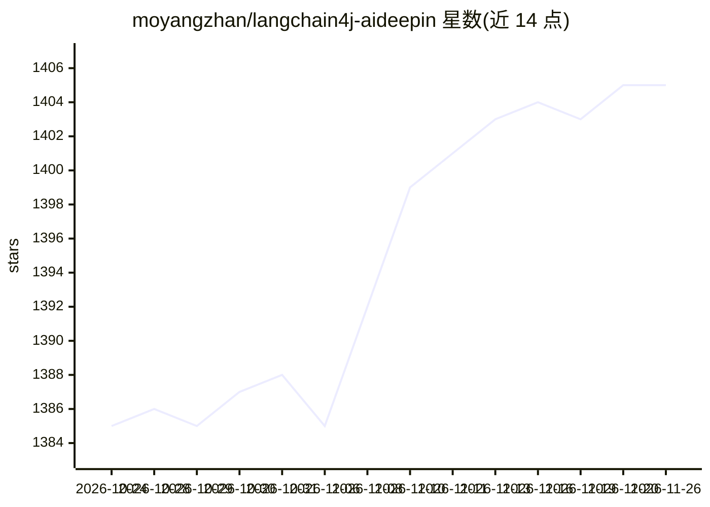

# moyangzhan/langchain4j-aideepin

⭐ 1,405 · Java · MIT · 推送 2026-11-25 · [GitHub](https://github.com/moyangzhan/langchain4j-aideepin) · [官网](http://www.aideepin.com) · 个人维护 · 中文 README

**企业构建智能业务助手的 AI 应用平台（聊天/RAG/工作流）**

基于 Spring Boot + langchain4j + langgraph4j 的后端与 Vue 3 前端组成的 AI 应用平台，面向需要快速搭建智能业务助手的团队。功能覆盖多角色聊天、文生图与图像编辑、向量检索与知识图谱双路的 RAG 知识库、可视化工作流编辑器、MCP 服务市场、语音输入输出（ASR/TTS）及长短记忆抽取。通过 OpenAPI 以 RESTful 形式开放角色、知识库与工作流，支持流式与阻塞两种响应模式；部署与升级文档另行提供。

## 筛选速览

| 维度 | 判定 | 备注 |
|---|---|---|
| AI 角色 | `ai-native` | 本体是模型或模型工具 |
| 许可风险 | `permissive` | MIT |
| 部署形态 | `library` | 以包/库形式分发 |
| 模型依赖 | local-ok | 支持本地模型 |
| 硬件要求 | — | 无带数字的原话,不猜 |
| 安装摩擦 | `low` | 无编译、无系统依赖或容器化 |
| 成熟度 | — | 结构信号不足 |

## 能力要点

- 知识库同时支持向量检索与知识图谱检索
- 可视化 AI 工作流编辑器，含条件分支、并行执行与人工反馈节点
- MCP 服务市场接入外部工具与数据源
- 对话长短记忆自动抽取，Open API 支持流式/阻塞模式

## 适用场景

- 为企业客服或业务助手搭建聊天与知识库问答
- 用可视化编辑器编排包含 LLM 调用与人工反馈的工作流
- 通过 MCP 市场给助手扩展外部工具
- 接入语音输入输出构建语音交互助手

## 场景标签

`RAG` `文档问答` `工作流自动化` `图像生成` · 领域:效率与自动化

## 证据(README 行号)

> L5: **LangChain4j-AIDeepIn — AI application platform.**
> L7: Integrates AI chat, knowledge base (RAG), workflow orchestration, long/short-term memory, MCP tools, and more — for 
> L36: |Knowledge Base (RAG)|Supports both vector search and knowledge graph retrieval|

## 星数曲线

2026-10-24 1,385 → 2026-11-26 1,405（+20）

---
*卡片 v1 · prompt 1.4 · 生成 2026-11-24 · 置信度 mid · 依据 README sha `3b3522bc17d1` · [字段定义](../../DATASET.md)*
