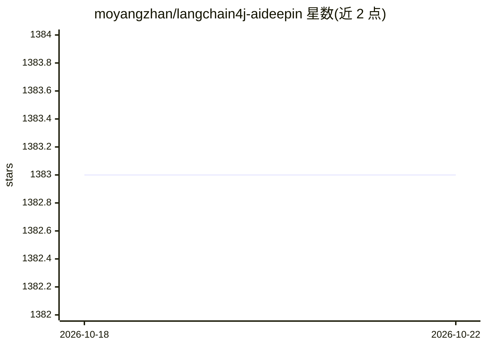

# moyangzhan/langchain4j-aideepin

⭐ 1,384 · Java · MIT · 推送 2026-10-09 · [GitHub](https://github.com/moyangzhan/langchain4j-aideepin) · [官网](http://www.aideepin.com) · 个人维护 · 中文 README

**自托管 AI 应用平台：聊天/绘画/RAG/工作流/语音与记忆**

基于 Spring Boot + langchain4j + langgraph4j 后端与 Vue 3 前端（管理端与用户端）构建的 AI 应用平台，功能包括多角色流式聊天、文生图与图片编辑（GPT-Image-2、DashScope Wanx 等）、向量与知识图谱混合检索的 RAG、可视化条件分支工作流、MCP 服务市场、文/语音多组合输入输出（TTS/ASR）与短期/长期记忆。集成 OpenAI、Qwen、SiliconFlow、Ollama、DeepSeek 等模型平台，提供 RESTful Open API 与 Docker 部署（详见 docker/README.md）。面向需要快速搭建智能业务助手的开发者和企业。

## 筛选速览

| 维度 | 判定 | 备注 |
|---|---|---|
| AI 角色 | `ai-native` | 本体是模型或模型工具 |
| 许可风险 | `permissive` | MIT |
| 部署形态 | `library` | 以包/库形式分发 |
| 模型依赖 | local-ok | 支持本地模型 |
| 硬件要求 | — | 无带数字的原话,不猜 |
| 安装摩擦 | `low` | 无编译、无系统依赖或容器化 |
| 成熟度 | — | 结构信号不足 |

## 能力要点

- 向量检索与知识图谱检索并存的 RAG 知识库
- 可视化工作流编辑器（条件分支/并行/LLM/人工反馈节点）
- 文⇄文/文⇄语音/语音⇄文/语音⇄语音的灵活输入输出组合
- 角色/知识库/工作流的 RESTful Open API，支持流式与阻塞模式

## 适用场景

- 私有部署带知识库检索的智能业务助手
- 通过可视化工作流编排 LLM 调用与人工审核流程
- 为外部系统提供带 API key 的聊天与知识库服务接口

## 场景标签

`RAG` `工作流自动化` `图像生成` · 领域:效率与自动化

## 证据(README 行号)

> L7: Integrates AI chat, knowledge base (RAG), workflow orchestration, long/short-term memory, MCP tools, and more — for 
> L35: |AI Chat|Multi-character (multi-conversation) with configurable prompts, models, and parameters. Streaming output|

## 星数曲线

2026-10-18 1,383 → 2026-10-22 1,383（+0）

---
*卡片 v1 · prompt 1.4 · 生成 2026-10-21 · 置信度 mid · 依据 README sha `c87b07dcd58d` · [字段定义](../../DATASET.md)*
