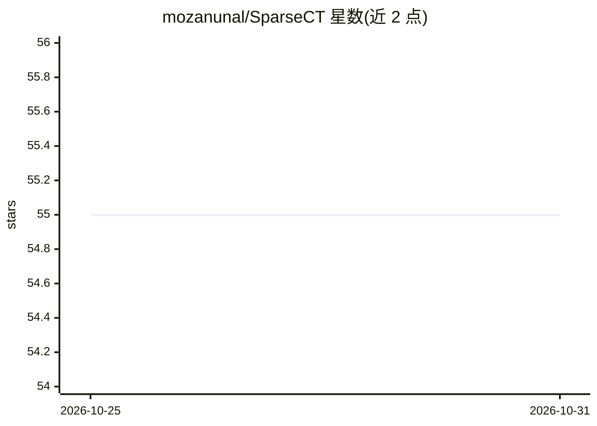

# mozanunal/SparseCT

⭐ 55 · Python · MIT · 推送 2026-10-23 · [GitHub](https://github.com/mozanunal/SparseCT) · 个人维护

**稀疏视图/低剂量CT重建算法的设计训练与基准框架**

CT 重建算法研究框架，提出自监督方法 Proj2Proj：在 4x4 网格上遮蔽部分 sinogram 像素，用 FBP 重建、CNN（默认 U-Net）去噪后前向投影，仅在保留像素上计算损失，训练无需正常剂量配对数据。附 Python API、CLI 示例、数据集训练脚本与 FBP/SART/TV/BM3D/监督 CNN 等基线，用于公平对比新方法。要求 Python 3.10+，可自动选择 CUDA 或 CPU，不含预训练 checkpoint。

## 筛选速览

| 维度 | 判定 | 备注 |
|---|---|---|
| AI 角色 | `ai-native` | 本体是模型或模型工具 |
| 许可风险 | `permissive` | MIT |
| 部署形态 | `library` | 以包/库形式分发 |
| 模型依赖 | — | README 未给出锁定关系 |
| 硬件要求 | — | 无带数字的原话,不猜 |
| 安装摩擦 | `medium` | 含编译或系统依赖之一 |
| 成熟度 | — | 结构信号不足 |

## 能力要点

- Proj2Proj 自监督训练仅用噪声投影，无需配对正常剂量目标
- 包含 FBP/SART/TV/BM3D/监督 CNN 等常规基线用于对比
- 提供 Python API、CPU 冒烟测试与 PNG 数据集训练脚本
- 兼容旧 Noise2Self 接口（N2SelfReconstructor，带弃用警告）

## 适用场景

- 快速原型化并对比稀疏视图 CT 重建方法
- 在自有 CT 切片数据上自监督训练重建网络
- 复现或扩展 Proj2Proj 论文方法

## 场景标签

`模型训练` `图像视频处理` `模型评测` · 领域:评测与运维

## 证据(README 行号)

> L3: **The proposed method in this repository is Proj2Proj**, a self-supervised method
> L18: Proj2Proj perturbs a subset of sinogram pixels on a 4 x 4 grid, reconstructs the
> L19: masked projections with filtered backprojection (FBP), denoises the image with a

## 星数曲线

2026-10-25 55 → 2026-10-31 55（+0）

---
*卡片 v1 · prompt 1.4 · 生成 2026-10-24 · 置信度 high · 依据 README sha `887a76d9f920` · [字段定义](../../DATASET.md)*
