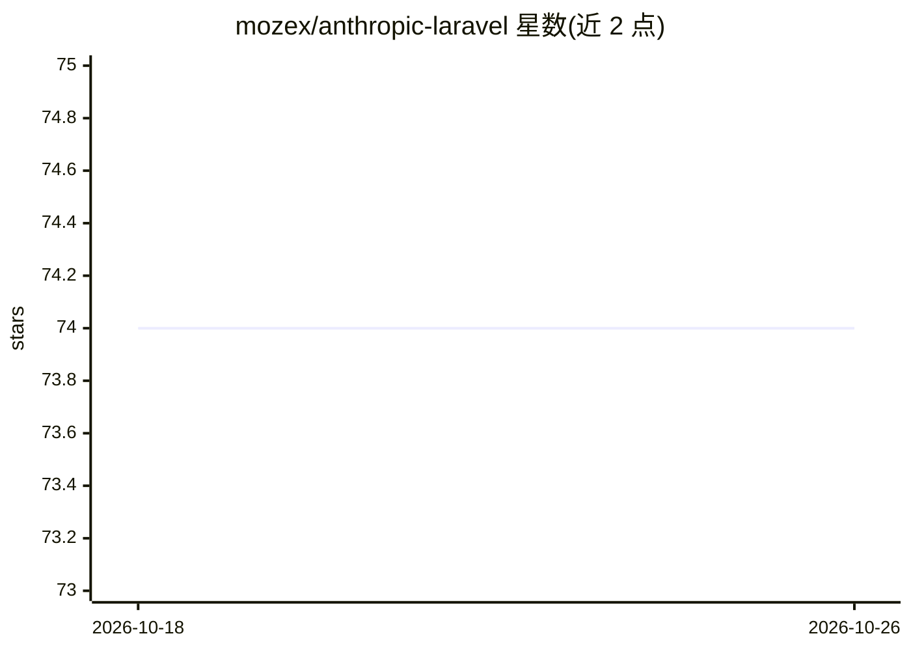

# mozex/anthropic-laravel

⭐ 74 · PHP · MIT · 推送 2026-10-23 · [GitHub](https://github.com/mozex/anthropic-laravel) · [官网](https://mozex.dev/docs/anthropic-laravel) · 个人维护

**Laravel 的 Anthropic API 集成包：Facade、配置发布与测试假件**

基于社区维护的 Anthropic PHP SDK 封装的 Laravel 包：提供服务容器集成、Anthropic Facade、可发布配置、artisan 安装命令（写入 ANTHROPIC_API_KEY 到 .env），以及配合 Laravel 测试习惯的 Anthropic::fake()。参数原样透传 API，覆盖 Messages、流式输出、工具调用、扩展思考、网页搜索、代码执行、引用、token 计数与批处理。要求 PHP 8.2+，通过 composer 安装；非 Laravel 项目可用其框架无关的底层 PHP 包。

## 筛选速览

| 维度 | 判定 | 备注 |
|---|---|---|
| AI 角色 | `ai-ecosystem` | LLM/agent 周边工具 |
| 许可风险 | `permissive` | MIT |
| 部署形态 | `None` |  |
| 模型依赖 | locked-api |  |
| 硬件要求 | — | 无带数字的原话,不猜 |
| 安装摩擦 | `low` | 无编译、无系统依赖或容器化 |
| 成熟度 | — | 结构信号不足 |

## 能力要点

- Anthropic Facade 覆盖 messages/models/batches/files/completions，无需手动实例化客户端
- Anthropic::fake() 测试假件：预设响应并断言发出的请求
- php artisan anthropic:install 一条命令发布配置并写入 API key
- 参数透传 API，新功能上线即可用

## 适用场景

- 在 Laravel 应用中接入 Anthropic Claude API
- 为调用 Anthropic 的代码编写可断言的单元测试
- 快速配置项目的 Anthropic 凭据与配置文件

## 场景标签

 · 领域:LLM 基础设施/API 客户端

## 证据(README 行号)

> L11: Laravel wrapper for Anthropic PHP, the community-maintained PHP SDK for the Anthropic API. Adds a Facade, a publish
> L29: **`Anthropic::` Facade for everything.** `Anthropic::messages()`, `Anthropic::models()`, `Anthropic::batches()`, `A

## 星数曲线

2026-10-18 74 → 2026-10-26 74（+0）

---
*卡片 v1 · prompt 1.4 · 生成 2026-10-24 · 置信度 high · 依据 README sha `a405a4e68360` · [字段定义](../../DATASET.md)*
