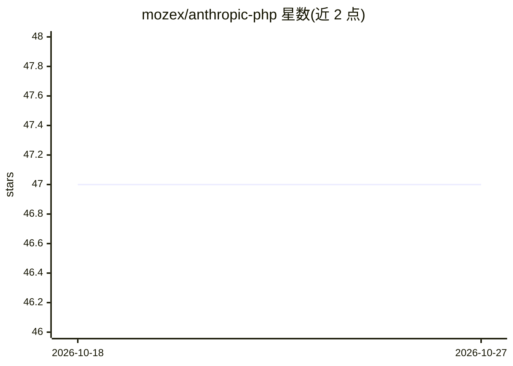

# mozex/anthropic-php

⭐ 47 · PHP · MIT · 推送 2026-10-23 · [GitHub](https://github.com/mozex/anthropic-php) · [官网](https://mozex.dev/docs/anthropic-php) · 个人维护

**PHP 开发者的 Anthropic API SDK：发消息、流式、工具调用**

社区维护的 PHP SDK，封装 Anthropic API：发送消息、流式响应、工具调用、扩展思考、网页搜索、代码执行、批处理、token 计数等。基于 PSR-18，可搭配 Guzzle、Symfony HTTP Client 等任意 HTTP 客户端；参数原样透传以保持前向兼容，响应为带类型标注的 readonly PHP 对象；内置 ClientFake 测试客户端可断言请求。要求 PHP 8.2+，通过 composer 安装。另有封装此 SDK 的 Laravel 集成包。

## 筛选速览

| 维度 | 判定 | 备注 |
|---|---|---|
| AI 角色 | `ai-ecosystem` | LLM/agent 周边工具 |
| 许可风险 | `permissive` | MIT |
| 部署形态 | `None` |  |
| 模型依赖 | locked-api |  |
| 硬件要求 | — | 无带数字的原话,不猜 |
| 安装摩擦 | `low` | 无编译、无系统依赖或容器化 |
| 成熟度 | — | 结构信号不足 |

## 能力要点

- 消息、流式、工具调用、扩展思考、批处理等 API 能力封装
- 基于 PSR-18，支持任意 HTTP 客户端（Guzzle/Symfony 等）
- 内置 ClientFake 测试客户端，无需 HTTP mock 库
- 响应为带类型标注的 readonly 对象，每个响应可读取速率限制信息

## 适用场景

- 在 PHP 应用中接入 Claude 完成对话与工具调用
- Laravel 项目外的 PHP 项目使用 Anthropic API
- 用内置 fake 客户端为 AI 功能编写测试

## 场景标签

 · 领域:LLM 基础设施/API 客户端

## 证据(README 行号)

> L11: A community-maintained PHP SDK for the Anthropic API. Send messages, stream responses, call tools, use extended thi
> L51: composer require mozex/anthropic-php

## 星数曲线

2026-10-18 47 → 2026-10-27 47（+0）

---
*卡片 v1 · prompt 1.4 · 生成 2026-10-25 · 置信度 high · 依据 README sha `f2b8947d788a` · [字段定义](../../DATASET.md)*
