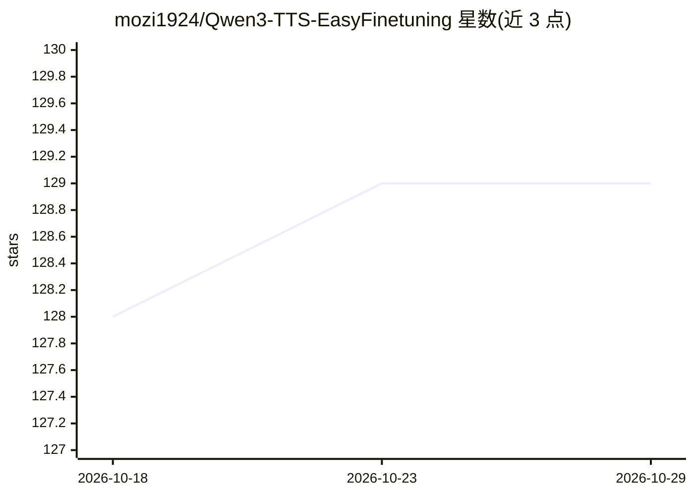

# mozi1924/Qwen3-TTS-EasyFinetuning

⭐ 129 · Python · Apache-2.0 · 推送 2026-05-29 · [GitHub](https://github.com/mozi1924/Qwen3-TTS-EasyFinetuning) · 个人维护 · 中文 README

**Qwen3-TTS 模型微调工作区：从原始音频到自定义语音模型**

面向 Qwen3-TTS 的监督微调（SFT）工具：将原始音频切分、ASR 转写、数据清洗、离散化 token 化、训练与推理整合为单一工作流。提供 Gradio WebUI 与统一 CLI 两种入口，内置针对 0.6B/1.7B 模型变体的预设训练参数，支持 CustomVoice 微调（先生成 speaker embedding 再训练）。推荐 Docker 部署，训练建议 NVIDIA GPU ≥16GB VRAM（1.7B 建议 24GB）、≥32GB RAM；Windows 原生 Python 路径不再维护，GPU 训练建议 Linux/WSL2。

## 筛选速览

| 维度 | 判定 | 备注 |
|---|---|---|
| AI 角色 | `ai-ecosystem` | LLM/agent 周边工具 |
| 许可风险 | `permissive` | Apache-2.0 |
| 部署形态 | `self-host` | docker 或自建部署 |
| 模型依赖 | — | README 未给出锁定关系 |
| 硬件要求 | `gpu-8g` | |
| 安装摩擦 | `low` | 无编译、无系统依赖或容器化 |
| 成熟度 | — | 结构信号不足 |

## 能力要点

- 音频切分→ASR 转写→清洗→token 化→训练→推理的整合流水线
- Gradio WebUI 与统一 CLI 双入口
- 0.6B / 1.7B 模型变体的预设训练参数
- 预配置 Docker 镜像开箱即用

## 适用场景

- 用自己的录音数据克隆一个稳定的目标音色
- 生产级语音合成前对 Qwen3-TTS 做跨语言微调以消除母语口音
- 通过 WebUI 在浏览器中完成数据准备、训练监控与推理测试

## 场景标签

`微调` `语音合成` · 领域:内容生成

## 证据(README 行号)

> L10: An easy-to-use workspace for fine-tuning the **Qwen3-TTS** model. This repository streamlines the entire process—fr
> L27: * **Integrated Pipeline**: Automated audio splitting, ASR transcription, dataset cleaning, and tokenization in a si

## 星数曲线

2026-10-18 128 → 2026-10-29 129（+1）

---
*卡片 v1 · prompt 1.4 · 生成 2026-10-22 · 置信度 high · 依据 README sha `05a16fd8efdb` · [字段定义](../../DATASET.md)*
