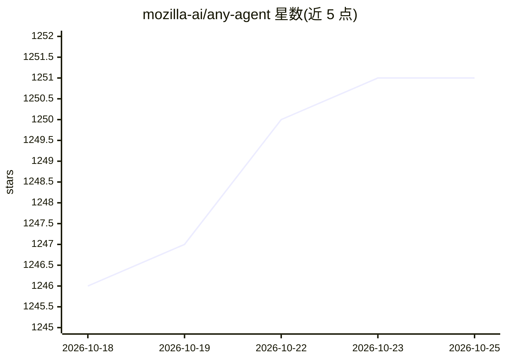

# mozilla-ai/any-agent

⭐ 1,252 · Python · Apache-2.0 · 推送 2026-10-01 · [GitHub](https://github.com/mozilla-ai/any-agent) · [官网](https://docs.mozilla.ai/any-agent) · 组织维护

**统一 API 调用与评测多种 agent 框架的 Python 库**

由 mozilla-ai 维护的 Python 库，提供一个统一接口来运行和评测不同 agent 框架（TinyAgent、Google ADK、LangChain、LlamaIndex、OpenAI Agents SDK、smolagents、Agno AI），通过相同的 AnyAgent.create 导入方式定义 agent 系统，配置 Mistral/OpenAI 等模型提供商的 API key。支持工具、追踪、服务化、评测及 MCP 工具集成与 A2A 多 agent 通信。项目处于软弃用状态：核心能力已拆分到 mozilla-ai-tinyagent，仅继续接受安全与缺陷修复，不计划新功能。

## 筛选速览

| 维度 | 判定 | 备注 |
|---|---|---|
| AI 角色 | `ai-ecosystem` | LLM/agent 周边工具 |
| 许可风险 | `permissive` | Apache-2.0 |
| 部署形态 | `library` | 以包/库形式分发 |
| 模型依赖 | — | README 未给出锁定关系 |
| 硬件要求 | — | 无带数字的原话,不猜 |
| 安装摩擦 | `low` | 无编译、无系统依赖或容器化 |
| 成熟度 | — | 结构信号不足 |

## 能力要点

- 单一 API 支持 7 种 agent 框架
- 通过 Agents-As-Tools 实现多 agent 系统
- 支持 MCP 工具集成与 A2A 协议部署
- 内含 agent 评测与回调等 Cookbook 示例

## 适用场景

- 在同一套代码下切换和评测不同 agent 框架
- 对比各框架的 agent 表现
- 用 MCP 工具或 A2A 协议构建多 agent 系统

## 场景标签

`Agent 框架` `模型评测` · 领域:Agent 开发

## 证据(README 行号)

> L13: A single interface to use and evaluate different agent frameworks.
> L18: > `any-agent` continues to be published and we'll take security/bug-fix PRs, but no new features are planned. Reach

## 星数曲线

2026-10-18 1,246 → 2026-10-25 1,251（+5）

---
*卡片 v1 · prompt 1.4 · 生成 2026-10-21 · 置信度 high · 依据 README sha `6262868baa19` · [字段定义](../../DATASET.md)*
