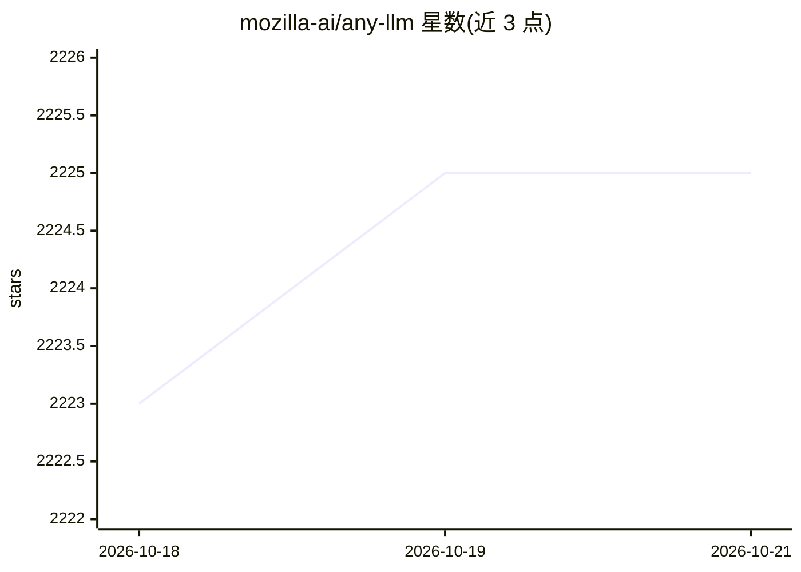

# mozilla-ai/any-llm

⭐ 2,225 · Python · Apache-2.0 · 推送 2026-10-19 · [GitHub](https://github.com/mozilla-ai/any-llm) · [官网](https://docs.mozilla.ai/any-llm) · 组织维护

**统一接口调用多家 LLM 提供商的 Python SDK**

mozilla-ai 维护的 Python SDK（3.11+），用一个 completion/AnyLLM 接口对接 OpenAI、Anthropic、Azure/Microsoft Foundry、Mistral、Ollama 等提供商，切换提供商只需改字符串并配置相应 API key。基于各官方 SDK 实现，框架无关、无需代理服务器，支持流式输出、工具调用与 OpenAI 风格 Responses API；另提供 provider:model 组合写法、list_models 查询，并附 LiteLLM 迁移说明。Apache 2.0 许可。

## 筛选速览

| 维度 | 判定 | 备注 |
|---|---|---|
| AI 角色 | `ai-ecosystem` | LLM/agent 周边工具 |
| 许可风险 | `permissive` | Apache-2.0 |
| 部署形态 | `library` | 以包/库形式分发 |
| 模型依赖 | local-ok | 支持本地模型 |
| 硬件要求 | — | 无带数字的原话,不猜 |
| 安装摩擦 | `low` | 无编译、无系统依赖或容器化 |
| 成熟度 | — | 结构信号不足 |

## 能力要点

- 单一接口切换多家 LLM 提供商，仅改字符串与密钥
- 基于官方提供商 SDK 实现，框架无关、无代理
- 支持流式、工具调用、Responses API 与 AnyLLM 类连接复用
- 提供 pip extras 按提供商安装（[openai]/[mistral,ollama]/[all]）

## 适用场景

- 在脚本或生产应用中用统一代码访问不同 LLM 提供商
- 从 LiteLLM 迁移而不改变环境变量与密钥配置
- 通过 OpenAI 兼容端点接入网关或本地服务器

## 场景标签

`模型网关` · 领域:Agent 开发

## 证据(README 行号)

> L19: **Communicate with any LLM provider using a single, unified interface.**
> L20: Switch between OpenAI, Anthropic, Azure / Microsoft Foundry, Mistral, Ollama, and more without changing your code.
> L93: - **Simple, unified interface** - Single function for all providers, switch models with just a string change

## 星数曲线

2026-10-18 2,223 → 2026-10-21 2,225（+2）

---
*卡片 v1 · prompt 1.4 · 生成 2026-10-21 · 置信度 high · 依据 README sha `4f412c1ddd2b` · [字段定义](../../DATASET.md)*
