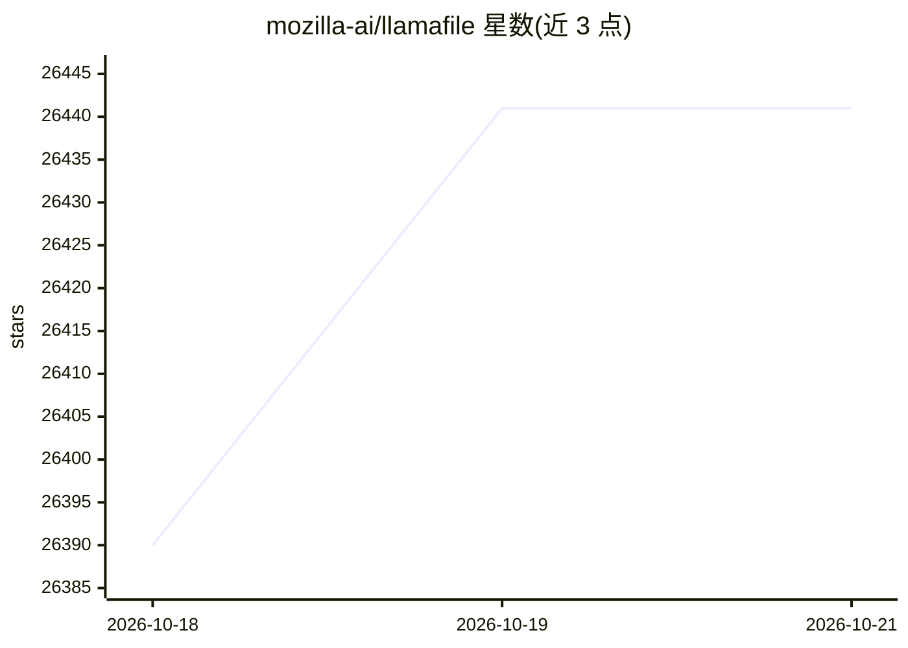

# mozilla-ai/llamafile

⭐ 26,441 · C++ · NOASSERTION · 推送 2026-10-12 · [GitHub](https://github.com/mozilla-ai/llamafile) · [官网](https://docs.mozilla.ai/llamafile) · 组织维护

**把 LLM 打包成单文件分发与本地运行的开发者工具**

将 llama.cpp 与 Cosmopolitan Libc 结合，把 LLM 运行时压缩为单个可执行文件（llamafile），在多数操作系统与 CPU 架构上本地运行，无需安装；另含基于 whisper.cpp 的单文件语音转文字工具 whisperfile。0.10.0 起改用新构建系统以跟进 llama.cpp 最新模型与功能，旧版本仍可从 releases 页获取。Windows 下可执行文件有 4GB 上限，超限时需以二进制搭配外部 GGUF 权重运行。

## 筛选速览

| 维度 | 判定 | 备注 |
|---|---|---|
| AI 角色 | `ai-ecosystem` | LLM/agent 周边工具 |
| 许可风险 | `none` | NOASSERTION |
| 部署形态 | `desktop` | 安装包/桌面程序 |
| 模型依赖 | local-ok | 支持本地模型 |
| 硬件要求 | — | 无带数字的原话,不猜 |
| 安装摩擦 | `low` | 无编译、无系统依赖或容器化 |
| 成熟度 | — | 结构信号不足 |

## 动量与使用信号

- 维护:`active` — 距上次 push 6.3 天,年发版 7,78 位贡献者
- 涨星:近 1 天 **+85**(自 20261016 起算)
- 平台:WINDOWS / MACOS / LINUX · 协议:—

## 能力要点

- LLM 运行时与模型打包为单文件可执行，免安装跨平台运行
- whisperfile：单文件语音转写与翻译工具
- 0.10.0 新构建系统对齐 llama.cpp 最新版本
- 支持下载预构建 llamafile 或从源码安装

## 适用场景

- 向最终用户分发开箱即用的本地 LLM
- 无安装条件下跨系统本地推理
- 本地音频转写与翻译

## 场景标签

`推理引擎` `语音识别` · 领域:感知与多模态

## 证据(README 行号)

> L13: **llamafile lets you distribute and run LLMs with a single file.**
> L19: combining llama.cpp with Cosmopolitan Libc into one
> L24: llamafile also includes **whisperfile**, a single-file speech-to-text tool built on whisper.cpp and the same Cosmop

## 星数曲线

2026-10-18 26,390 → 2026-10-21 26,441（+51）

---
*卡片 v1 · prompt 1.4 · 生成 2026-10-18 · 置信度 high · 依据 README sha `68512a7fd6d3` · [字段定义](../../DATASET.md)*
