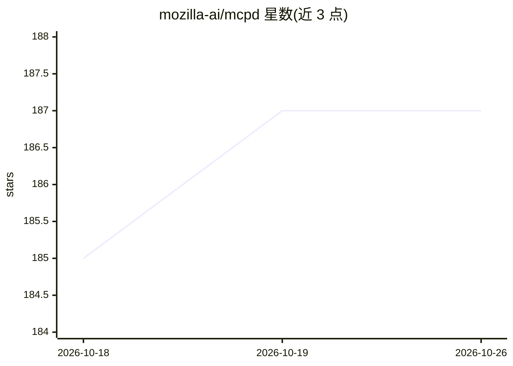

# mozilla-ai/mcpd

⭐ 187 · Go · Apache-2.0 · 推送 2026-10-23 · [GitHub](https://github.com/mozilla-ai/mcpd) · [官网](https://docs.mozilla.ai/mcpd) · 组织维护

**声明式管理 MCP 服务器的守护进程，统一暴露 HTTP 接口**

Mozilla AI 开发的 mcpd 守护进程：以 .mcpd.toml 声明式配置管理 MCP 服务器生命周期，将 MCP 服务器以 STDIO 子进程方式拉起并代理为 HTTP 端点，处理密钥注入与环境迁移（本地与容器同一配置）。支持 uv/npx/Docker 三类运行时承载的服务器，提供 Python、JavaScript SDK 与 Go/.NET/Python 插件 SDK，社区另有 PHP 插件 SDK。安装经 Homebrew 或 GitHub releases/本地 Go 构建获得二进制。

## 筛选速览

| 维度 | 判定 | 备注 |
|---|---|---|
| AI 角色 | `ai-ecosystem` | LLM/agent 周边工具 |
| 许可风险 | `permissive` | Apache-2.0 |
| 部署形态 | `None` |  |
| 模型依赖 | — | README 未给出锁定关系 |
| 硬件要求 | — | 无带数字的原话,不猜 |
| 安装摩擦 | `medium` | 含编译或系统依赖之一 |
| 成熟度 | — | 结构信号不足 |

## 能力要点

- 以 .mcpd.toml 声明式定义工具基础设施
- MCP 服务器以 STDIO 子进程运行并代理为统一 HTTP API
- 本地与容器化生产环境使用同一配置，含密钥注入与导出脱敏
- 提供 Python/JS SDK 与 Go/.NET/Python 插件 SDK（社区 PHP）

## 适用场景

- 统一管理多个 MCP 服务器供 agent 调用
- 把本地 agent 工具配置迁移到容器化生产环境
- 通过统一 HTTP API 跨语言访问 MCP 工具

## 场景标签

`Agent 框架` · 领域:Agent 开发

## 证据(README 行号)

> L9: `mcpd` is a daemon that manages your MCP servers via declarative configuration, exposing them as clean HTTP endpoint
> L13: Under the hood, mcpd spawns MCP servers as STDIO subprocesses and proxies requests over HTTP.
> L158: |Tools|mcpd|**(You are here)** Tool sandbox & router|

## 星数曲线

2026-10-18 185 → 2026-10-26 187（+2）

---
*卡片 v1 · prompt 1.4 · 生成 2026-10-22 · 置信度 high · 依据 README sha `10c2ab80b71e` · [字段定义](../../DATASET.md)*
