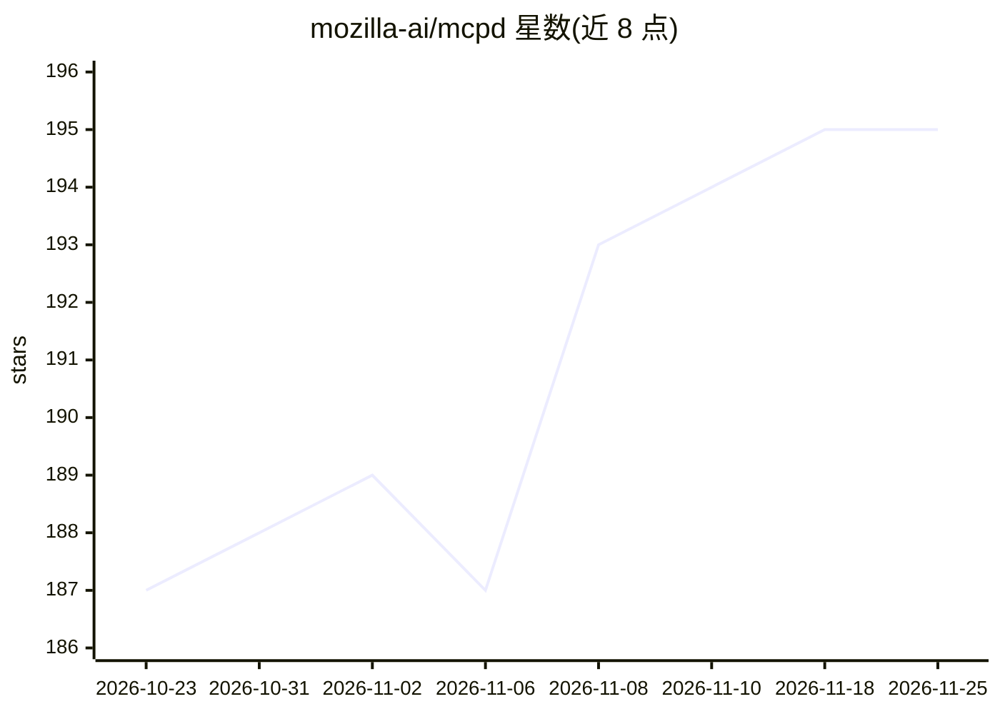

# mozilla-ai/mcpd

⭐ 195 · Go · Apache-2.0 · 推送 2026-11-19 · [GitHub](https://github.com/mozilla-ai/mcpd) · [官网](https://docs.mozilla.ai/mcpd) · 组织维护

**以声明式配置管理 MCP 服务器的守护进程，供开发与生产部署**

mcpd 是一个守护进程，通过 .mcpd.toml 声明式配置管理 MCP 服务器，将其作为 STDIO 子进程启动并通过统一 HTTP API 暴露，处理生命周期管理、密钥注入与环境间配置迁移。面向需要在本地开发到容器化云部署间复用 agent 工具基础设施的工程团队。提供 Homebrew 安装包、Python/JavaScript SDK 及 Go/.NET/Python/Rust 插件 SDK，并通过 mcpd-proxy 将所管理的 MCP 服务器接入 VS Code 或 Cursor。

## 筛选速览

| 维度 | 判定 | 备注 |
|---|---|---|
| AI 角色 | `ai-ecosystem` | LLM/agent 周边工具 |
| 许可风险 | `permissive` | Apache-2.0 |
| 部署形态 | `library` | 以包/库形式分发 |
| 模型依赖 | — | README 未给出锁定关系 |
| 硬件要求 | — | 无带数字的原话,不猜 |
| 安装摩擦 | `medium` | 含编译或系统依赖之一 |
| 成熟度 | — | 结构信号不足 |

## 能力要点

- 声明式 .mcpd.toml 配置定义工具基础设施
- MCP 服务器以 STDIO 子进程运行并代理为 HTTP 端点
- 支持 uvx/npx/docker 三种服务器启动方式
- 提供 Python/JavaScript SDK 与多语言插件 SDK

## 适用场景

- 在本地与容器化生产环境中用同一份配置运行 agent 所需的 MCP 工具
- 通过统一 HTTP API 让不同语言的 agent 调用 MCP 工具
- 在 CI/CD 流水线中使用脱敏后的配置模板
- 通过单一连接将多个 MCP 服务器接入 VS Code 或 Cursor

## 场景标签

 · 领域:LLM 基础设施/MCP 工具管理

## 证据(README 行号)

> L9: `mcpd` is a daemon that manages your MCP servers via declarative configuration, exposing them as clean HTTP endpoint
> L83: Engineering teams build agents that work locally, then struggle to make them production-ready across environments. 
> L173: |Tools|mcpd|**(You are here)** Tool sandbox & router|

## 星数曲线

2026-10-23 187 → 2026-11-25 195（+8）

---
*卡片 v1 · prompt 1.4 · 生成 2026-11-25 · 置信度 high · 依据 README sha `ae2a52e04a43` · [字段定义](../../DATASET.md)*
