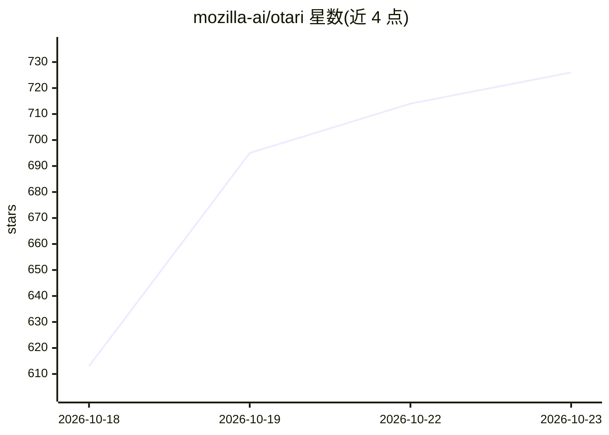

# mozilla-ai/otari

⭐ 726 · Python · Apache-2.0 · 推送 2026-10-22 · [GitHub](https://github.com/mozilla-ai/otari) · [官网](https://otari.ai/docs/gateway) · 组织维护

**自托管的 OpenAI 兼容 LLM 网关：统一接入 40+ 供应商**

Mozilla AI 维护的自托管 LLM 网关：以一个 OpenAI/Anthropic 兼容端点路由到 40+ 模型供应商，在应用与供应商之间认证请求、解析凭证、在请求前执行预算检查并在结算后记录用量。提供可撤销的虚拟 API key（用户/工作区/模型级作用域）、本地路由策略（故障转移、权重、学习式选择），以及可选的代码执行、web 搜索、MCP 与推理防护栏。通过 Docker/Compose 部署，带管理面板与 Swagger 文档；提供商调用经由 any-llm。

## 筛选速览

| 维度 | 判定 | 备注 |
|---|---|---|
| AI 角色 | `ai-ecosystem` | LLM/agent 周边工具 |
| 许可风险 | `permissive` | Apache-2.0 |
| 部署形态 | `self-host` | docker 或自建部署 |
| 模型依赖 | — | README 未给出锁定关系 |
| 硬件要求 | — | 无带数字的原话,不猜 |
| 安装摩擦 | `low` | 无编译、无系统依赖或容器化 |
| 成熟度 | — | 结构信号不足 |

## 能力要点

- 一个 OpenAI/Anthropic 兼容端点路由 40+ 供应商
- 虚拟 API key 与请求前预算检查、用量记录
- 本地路由策略：failover、加权、learned selection
- 可选代码沙箱、web 搜索、MCP、guardrails 与文件理解

## 适用场景

- 团队统一管理与审计多个 LLM 供应商的调用与开销
- 为成员或项目签发可撤销、限额的虚拟 API key
- 通过故障转移和路由策略保障 LLM 调用可用性

## 场景标签

`模型网关` · 领域:Agent 开发

## 证据(README 行号)

> L20: Otari sits between your applications and model providers. It authenticates
> L29: - One OpenAI and Anthropic-compatible endpoint for many providers

## 星数曲线

2026-10-18 613 → 2026-10-23 726（+113）

---
*卡片 v1 · prompt 1.4 · 生成 2026-10-21 · 置信度 high · 依据 README sha `58342934f792` · [字段定义](../../DATASET.md)*
