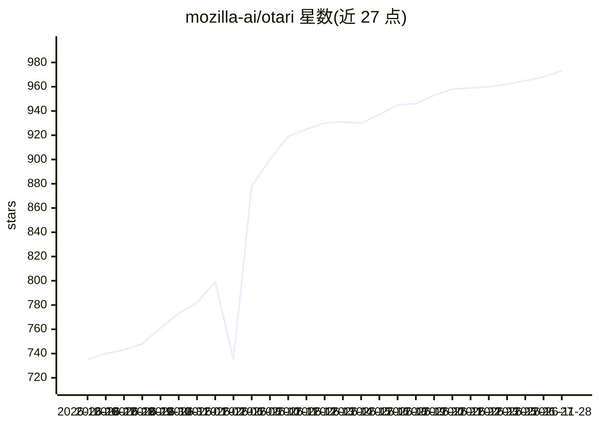

# mozilla-ai/otari

⭐ 973 · Python · Apache-2.0 · 推送 2026-11-27 · [GitHub](https://github.com/mozilla-ai/otari) · [官网](https://otari.ai/) · 组织维护 · 中文 README

**自托管 AI 网关：统一端点接 40+ 模型服务商，管理密钥与预算**

Otari 部署在应用与模型服务商之间：认证请求、托管服务商凭证、派发前执行预算检查、事后记录用量。提供 OpenAI 与 Anthropic 兼容端点，支持可撤销的虚拟 API 密钥（用户/工作区/模型范围）、本地路由策略（故障转移、条件选择、流量拆分、限速溢出），以及可选的代码执行、网页搜索、MCP 与推理护栏。经 any-llm 调用服务商，默认 SQLite 存储并可切换 PostgreSQL，自带管理仪表盘。由 mozilla-ai 维护，Apache 2.0 许可。

## 筛选速览

| 维度 | 判定 | 备注 |
|---|---|---|
| AI 角色 | `ai-ecosystem` | LLM/agent 周边工具 |
| 许可风险 | `permissive` | Apache-2.0 |
| 部署形态 | `self-host` | docker 或自建部署 |
| 模型依赖 | — | README 未给出锁定关系 |
| 硬件要求 | — | 无带数字的原话,不猜 |
| 安装摩擦 | `low` | 无编译、无系统依赖或容器化 |
| 成熟度 | — | 结构信号不足 |

## 能力要点

- 单个 OpenAI/Anthropic 兼容端点路由至 40+ 服务商
- 可撤销虚拟密钥与预算前置检查、用量结算记录
- 本地路由策略：failover、流量拆分、限速溢出
- 自带仪表盘管理密钥、预算、路由与用量

## 适用场景

- 团队统一管理多家模型服务商的凭证与密钥分发
- 为各项目设置预算并追踪 LLM 调用花费
- 配置故障转移与流量拆分的本地路由策略

## 场景标签

`模型网关` · 领域:Agent 开发

## 证据(README 行号)

> L3: **An AI gateway you own and run.**
> L5: Route one endpoint to 40+ providers, issue virtual keys, enforce budgets, and
> L22: Otari sits between your applications and model providers. It authenticates

## 星数曲线

2026-10-26 735 → 2026-11-28 973（+238）

---
*卡片 v1 · prompt 1.4 · 生成 2026-11-24 · 置信度 high · 依据 README sha `f24d6a414fb0` · [字段定义](../../DATASET.md)*
