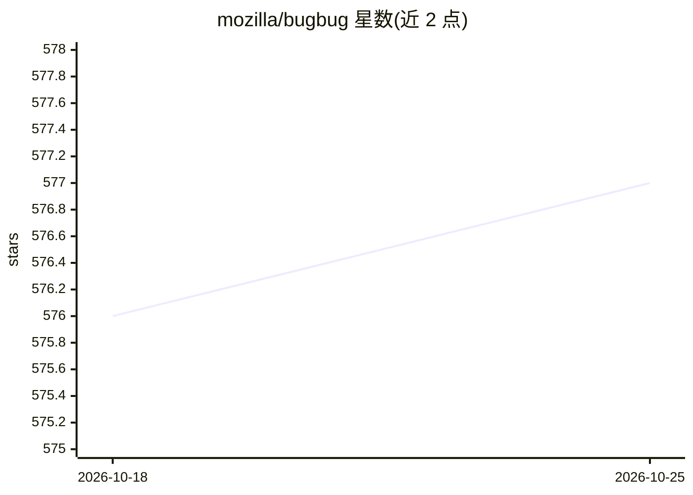

# mozilla/bugbug

⭐ 577 · Python · MPL-2.0 · 推送 2026-10-23 · [GitHub](https://github.com/mozilla/bugbug) · 组织维护

**面向软件工程的机器学习平台：bug 分类与缺陷预测**

Mozilla 维护的软件工程机器学习平台，提供约 18 个分类器用于 bug 与质量管理任务：建议 bug 指派人、区分缺陷/功能请求、识别回归、选择需运行的测试、检测垃圾 bug 等。从 Bugzilla 与 mozilla-central 仓库检索与挖掘数据，用 scikit-learn/Keras 训练模型，未训练时可自动下载已训练模型，也支持在 Taskcluster CI 上触发训练。当前聚焦 Mozilla（Firefox/Bugzilla/GitHub）用例，训练约需 30 分钟以上，需 Python 3.14+。

## 筛选速览

| 维度 | 判定 | 备注 |
|---|---|---|
| AI 角色 | `ai-native` | 本体是模型或模型工具 |
| 许可风险 | `permissive` | MPL-2.0 |
| 部署形态 | `self-host` | docker 或自建部署 |
| 模型依赖 | — | README 未给出锁定关系 |
| 硬件要求 | — | 无带数字的原话,不猜 |
| 安装摩擦 | `low` | 无编译、无系统依赖或容器化 |
| 成熟度 | — | 结构信号不足 |

## 能力要点

- 约 18 个分类器覆盖 bug 分诊、回归检测、测试选择、缺陷预测
- 从 Bugzilla 和 mozilla-central 仓库自动检索/挖掘训练数据
- 未训练时自动下载已训练模型，也可在 Taskcluster CI 触发训练
- 训练数据可独立于 bugbug 使用

## 适用场景

- 为 bug 跟踪系统自动分派组件与指派人
- 预测补丁的回归/测试失败风险以安排审查优先级
- 为给定补丁选择需运行的测试集合

## 场景标签

`MLOps` · 领域:训练与推理

## 证据(README 行号)

> L9: Bugbug aims at leveraging machine learning techniques to help with bug and quality management, and other software en
> L22: - **assignee** - The aim of this classifier is to suggest an appropriate assignee for a bug.
> L52: - **testselect** - The aim of this classifier is to select relevant tests to run for a given patch.

## 星数曲线

2026-10-18 576 → 2026-10-25 577（+1）

---
*卡片 v1 · prompt 1.4 · 生成 2026-10-21 · 置信度 mid · 依据 README sha `ef41545e3c3f` · [字段定义](../../DATASET.md)*
