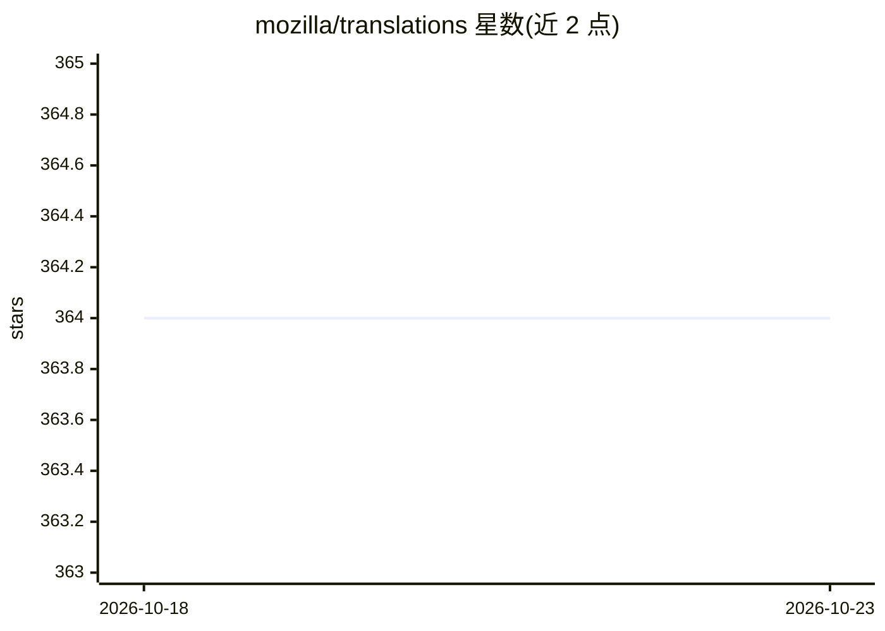

# mozilla/translations

⭐ 364 · C++ · MPL-2.0 · 推送 2026-09-25 · [GitHub](https://github.com/mozilla/translations) · [官网](https://mozilla.github.io/translations/) · 组织维护

**Firefox 网页翻译模型的训练管线与推理引擎代码**

Mozilla 维护的机器翻译项目，包含端到端翻译模型训练管线（基于 Marian 引擎）与驱动 Firefox Translations 的推理代码；训练好的模型托管于公开 GCS 存储桶，模型文件以 MPL 2.0 分发，兼容 bergamot-translator 并自 Firefox 118 起支持网页翻译。工作流编排支持 Taskcluster（GCP+本地混合云）与 Snakemake（本地或 Slurm 集群，但已不再维护集成）；训练指标解析后发布到 Weights & Biases 面板。项目源自欧盟资助的 Bergamot 项目。

## 筛选速览

| 维度 | 判定 | 备注 |
|---|---|---|
| AI 角色 | `ai-native` | 本体是模型或模型工具 |
| 许可风险 | `permissive` | MPL-2.0 |
| 部署形态 | `None` |  |
| 模型依赖 | — | README 未给出锁定关系 |
| 硬件要求 | — | 无带数字的原话,不猜 |
| 安装摩擦 | `low` | 无编译、无系统依赖或容器化 |
| 成熟度 | — | 结构信号不足 |

## 能力要点

- 端到端语言对翻译模型训练管线（基于 Marian 引擎）
- 模型以 MPL 2.0 许可分发，兼容 bergamot-translator
- Taskcluster 混合云与 Snakemake 两种工作流编排
- 训练指标发布到公开 Weights & Biases 面板

## 适用场景

- 为语言对训练机器翻译模型并接入 Firefox 翻译
- 研究低资源语言翻译模型的训练调参
- 复用 Mozilla 翻译模型文件与 bergamot-translator 集成

## 场景标签

`模型训练` · 领域:训练与推理

## 证据(README 行号)

> L3: Training pipelines and the inference engine for Firefox Translations machine translation models.
> L15: The pipeline is capable of training a translation model for a language pair end to end.

## 星数曲线

2026-10-18 364 → 2026-10-23 364（+0）

---
*卡片 v1 · prompt 1.4 · 生成 2026-10-21 · 置信度 high · 依据 README sha `e34ff34ba618` · [字段定义](../../DATASET.md)*
