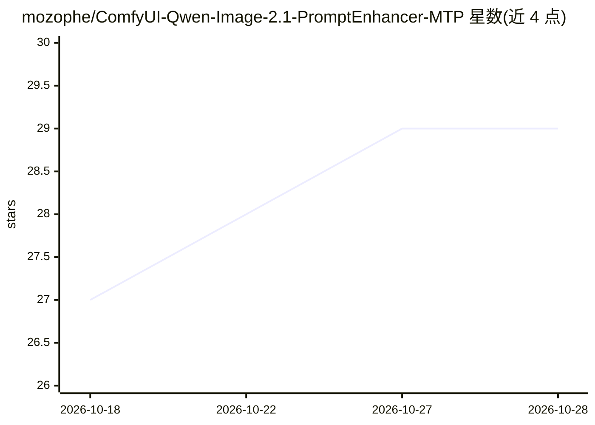

# mozophe/ComfyUI-Qwen-Image-2.1-PromptEnhancer-MTP

⭐ 28 · Python · MIT · 推送 2026-10-11 · [GitHub](https://github.com/mozophe/ComfyUI-Qwen-Image-2.1-PromptEnhancer-MTP) · 个人维护

**在 ComfyUI 中运行 Qwen-Image 2.1 官方提示词增强器的节点**

面向 ComfyUI 用户的自定义节点：将简短想法或编辑指令交给 Qwen-Image 2.1 官方提示词增强器（PE），输出详细提示词。支持两种后端：llama.cpp（NVIDIA GPU，独立 llama-server 进程，官方设置下文生图约 2×、编辑约 3.5× 于 ComfyUI 自带文本生成速度）与 ComfyUI 内置（任意 ComfyUI 支持的 GPU，约 1.4–1.7×）。两种后端均启用 MTP 多 token 预测；支持最多 10 张输入图像编辑、社区 abliterated 变体；模型与 llama-server 首次使用自动下载。限制：llama.cpp 后端需 NVIDIA 8 GB 以上显存、驱动 528.33/525.60.13 以上；建议 32 GB 系统内存。

## 筛选速览

| 维度 | 判定 | 备注 |
|---|---|---|
| AI 角色 | `ai-native` | 本体是模型或模型工具 |
| 许可风险 | `permissive` | MIT |
| 部署形态 | `desktop` | 安装包/桌面程序 |
| 模型依赖 | local-ok | 支持本地模型 |
| 硬件要求 | `gpu-8g` | |
| 安装摩擦 | `medium` | 含编译或系统依赖之一 |
| 成熟度 | — | 结构信号不足 |

## 能力要点

- 双后端：llama.cpp（独立 llama-server 进程）与 ComfyUI 内置，均启用 MTP 多 token 预测
- 使用 Qwen 官方系统提示词与采样设置，增强结果与模型推理分离输出
- 模型与 llama-server 首次使用自动下载，支持 Q8_0/Q4_K_M 量化与 kv_cache/vision_on_cpu 等显存选项
- 支持最多 10 张任意尺寸输入图像的多图编辑，以及社区 abliterated 变体

## 适用场景

- 在 ComfyUI 工作流前自动把简短想法扩写为 Qwen-Image 2.1 适用的详细提示词
- 用自然语言编辑指令配合多张输入图像做图像编辑
- 在 NVIDIA GPU 上用 llama.cpp 后端加速提示词生成

## 场景标签

`提示工程` `图像生成` · 领域:Agent 开发

## 证据(README 行号)

> L23: - **llama.cpp**: for NVIDIA GPUs. It runs the PE in a separate llama-server process with MTP, at about **2×** (text
> L119: **Why use it:** it generates the enhanced prompt much faster than the ComfyUI backend: with MTP on both, 47 vs 34 

## 星数曲线

2026-10-18 27 → 2026-10-28 29（+2）

---
*卡片 v1 · prompt 1.4 · 生成 2026-10-26 · 置信度 mid · 依据 README sha `b6506745cf59` · [字段定义](../../DATASET.md)*
