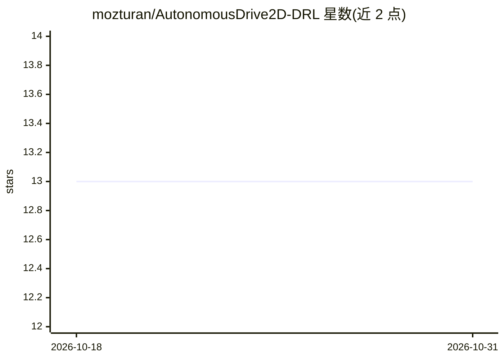

# mozturan/AutonomousDrive2D-DRL

⭐ 13 · Jupyter Notebook · MIT · 推送 2026-03-24 · [GitHub](https://github.com/mozturan/AutonomousDrive2D-DRL) · 个人维护

**车道保持自动驾驶的 DRL 研究代码：SAC 与 DDQN-PER 对比**

基于 Highway-Env 仿真环境的深度强化学习研究项目：在赛道场景下让车辆执行车道保持与目标速度维持任务，对比 SAC 与带优先经验回放的 DDQN-PER 两种算法在运动学状态输入与灰度鸟瞰图输入两种观测空间下的表现。动作空间支持仅转向与转向加油门两种设定，DDQN 将连续动作离散化为 55 档。配套一篇 2023 年会议论文并附训练结果视频与性能曲线图。README 未给出安装运行命令。

## 筛选速览

| 维度 | 判定 | 备注 |
|---|---|---|
| AI 角色 | `ai-native` | 本体是模型或模型工具 |
| 许可风险 | `permissive` | MIT |
| 部署形态 | `None` |  |
| 模型依赖 | — | README 未给出锁定关系 |
| 硬件要求 | — | 无带数字的原话,不猜 |
| 安装摩擦 | `low` | 无编译、无系统依赖或容器化 |
| 成熟度 | — | 结构信号不足 |

## 能力要点

- 对比 SAC 与 DDQN-PER 两种深度强化学习算法
- 测试运动学输入与鸟瞰图输入两种观测空间
- 基于 Highway-Env 的赛道车道保持与目标速度维持任务
- 配套 2023 年会议论文及训练结果视频

## 适用场景

- 复现 SAC/DDQN 车道保持对比实验
- 研究观测空间选择对强化学习算法的影响
- 作为 Highway-Env 上的 DRL 实验代码参考

## 场景标签

`强化学习` · 领域:训练与推理

## 证据(README 行号)

> L28: A comprehensive comparative analysis of two formidable deep reinforcement learning algorithms: **Soft Actor-Critic 
> L37: - Using Highway-Env simulation.
> L40: - Testing two different deep reinforcement learning algorithms (SAC and DDQN-PER) with two different observation ty

## 星数曲线

2026-10-18 13 → 2026-10-31 13（+0）

---
*卡片 v1 · prompt 1.4 · 生成 2026-10-31 · 置信度 high · 依据 README sha `c0fa1451c788` · [字段定义](../../DATASET.md)*
