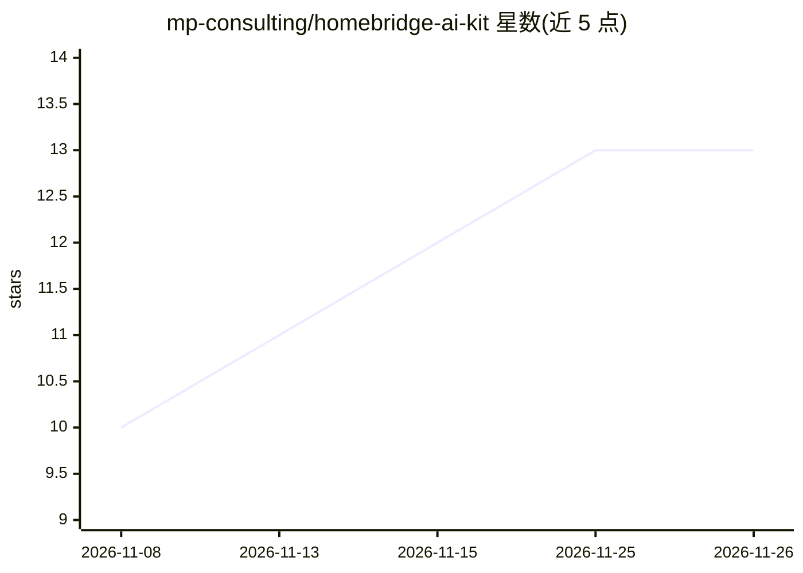

# mp-consulting/homebridge-ai-kit

⭐ 13 · TypeScript · MIT · 推送 2026-11-23 · [GitHub](https://github.com/mp-consulting/homebridge-ai-kit) · 组织维护

**让 AI 助手通过 MCP 控制与管理 Homebridge 智能家居的工具包**

面向 Homebridge 智能家居平台的 AI 工具包，包含三部分：一个 MCP 服务器，让 Claude Desktop、Claude Code、Cursor 等 AI 客户端通过 stdio 或 HTTP 控制配件、管理插件、编辑配置和读取日志（43 个工具、资源订阅与内置提示词）；一个带 provider 适配器与 agent 循环的 Assistant 库，内置日志诊断、配置生成、设备错误解释等功能；以及一个 Homebridge 插件，提供设置页选择 provider 与模型、生成客户端配置。通过客户端 token 与 Homebridge API token 分层控制权限，写入操作记录审计日志。通过 npm 全局安装。

## 筛选速览

| 维度 | 判定 | 备注 |
|---|---|---|
| AI 角色 | `ai-ecosystem` | LLM/agent 周边工具 |
| 许可风险 | `permissive` | MIT |
| 部署形态 | `library` | 以包/库形式分发 |
| 模型依赖 | local-ok | 支持本地模型 |
| 硬件要求 | — | 无带数字的原话,不猜 |
| 安装摩擦 | `low` | 无编译、无系统依赖或容器化 |
| 成熟度 | — | 结构信号不足 |

## 能力要点

- MCP 服务器提供 43 个工具：配件控制、场景、配置读写、插件管理与日志检索
- 多 provider 适配器支持 Claude、OpenAI、Gemini 及 OpenAI 兼容服务器（含 Ollama、LM Studio、vLLM）
- 客户端 token 分 read/control/admin 三级权限，写操作记录审计日志
- 其他 Homebridge 插件可通过一条调用接入 Assistant UI 路由

## 适用场景

- 用 Claude Desktop 自然语言控制家里的灯光、传感器与场景
- 让 AI 助手诊断 Homebridge 日志和设备报错
- 通过对话生成和修补 Homebridge 插件配置
- 给自研 Homebridge 插件的设置页添加 AI 解释功能

## 场景标签

`AI 助手` · 领域:对话与助手

## 证据(README 行号)

> L5: - **An MCP server** that lets AI assistants (Claude Desktop, Claude Code, Cursor) control accessories, manage plugin
> L28: **MCP tools** (43): accessories (list, get, control with value checks, bulk control with `dryRun`, locks / garage d
> L44: |`anthropic`|`claude-sonnet-5-5`|required|yes|yes|1M (200K for Haiku)|

## 星数曲线

2026-11-08 10 → 2026-11-26 13（+3）

---
*卡片 v1 · prompt 1.4 · 生成 2026-11-18 · 置信度 high · 依据 README sha `b3aab4a835c2` · [字段定义](../../DATASET.md)*
