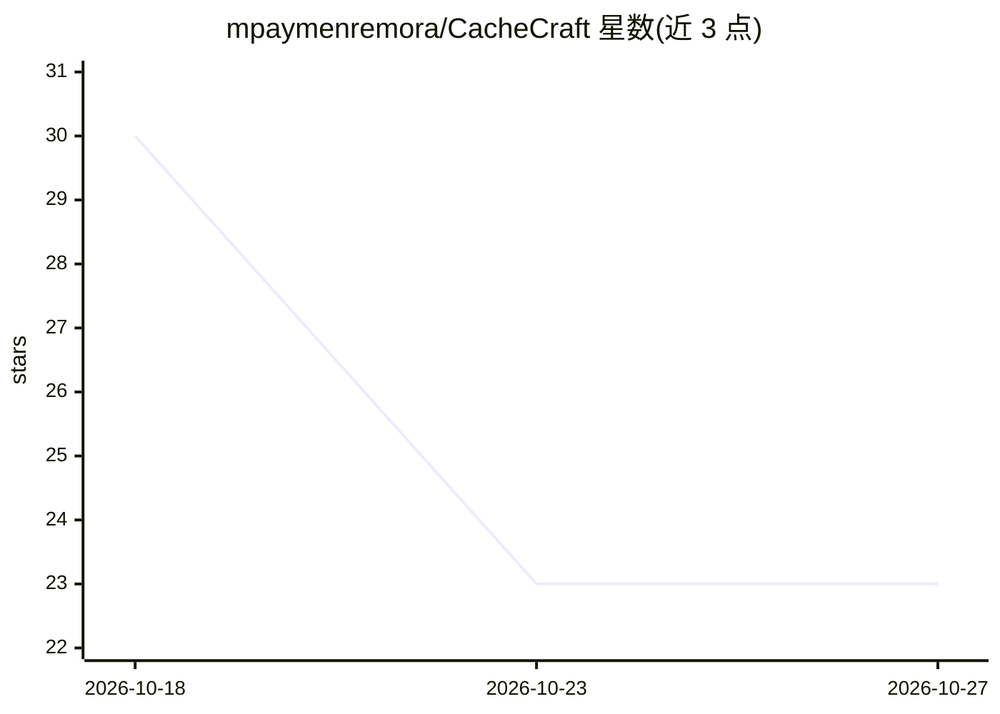

# mpaymenremora/CacheCraft

⭐ 23 · Python · Apache-2.0 · 推送 2026-09-04 · [GitHub](https://github.com/mpaymenremora/CacheCraft) · 个人维护

**语义缓存策略基准工具：回放请求日志测各缓存策略收益**

面向在昂贵后端（如 LLM 端点、搜索集群）前加缓存的团队的基准工具：读取 JSONL 格式的请求 trace（仅需 route、prompt、cost_ms 三字段），按时间序回放，对比 exact/prefix/overlap/route 四种匹配策略的命中率、避免延迟与匹配质量，并按加权公式合成 trade-off score 输出对比表或 JSON。Python 端仅依赖 3.11 标准库，另有 Go 版伴随 runner 用于大 trace 单遍回放，两者共享同一规范化契约。不含真实缓存实现，只做策略评估。

## 筛选速览

| 维度 | 判定 | 备注 |
|---|---|---|
| AI 角色 | `ai-ecosystem` | LLM/agent 周边工具 |
| 许可风险 | `permissive` | Apache-2.0 |
| 部署形态 | `None` |  |
| 模型依赖 | — | README 未给出锁定关系 |
| 硬件要求 | — | 无带数字的原话,不猜 |
| 安装摩擦 | `low` | 无编译、无系统依赖或容器化 |
| 成熟度 | — | 结构信号不足 |

## 能力要点

- 四种匹配策略（exact/prefix/overlap/route）在同一 trace 上对比回放
- trade-off score 融合避免延迟(0.5)、命中率(0.3)、平均质量(0.2)三轴
- Python 版仅用标准库，无第三方依赖；Go 版共享同一规范化规则
- JSONL trace 仅需 route/prompt/cost_ms 三字段，无需后端响应

## 适用场景

- 在上线缓存前用自己的真实流量测各策略的命中与延迟收益
- 为模糊匹配策略挑选安全阈值
- 将缓存策略对比报告接入 dashboard 或 CI 门禁

## 场景标签

`模型评测` · 领域:评测与运维

## 证据(README 行号)

> L5: **CacheCraft is a semantic cache strategy bench.** It takes a recorded trace of
> L27: Teams putting a cache in front of an expensive backend — an LLM endpoint, a
> L217: Hit rate alone lies. CacheCraft blends three axes into a single **trade-off

## 星数曲线

2026-10-18 30 → 2026-10-27 23（-7）

---
*卡片 v1 · prompt 1.4 · 生成 2026-10-27 · 置信度 high · 依据 README sha `51d777a6afdd` · [字段定义](../../DATASET.md)*
