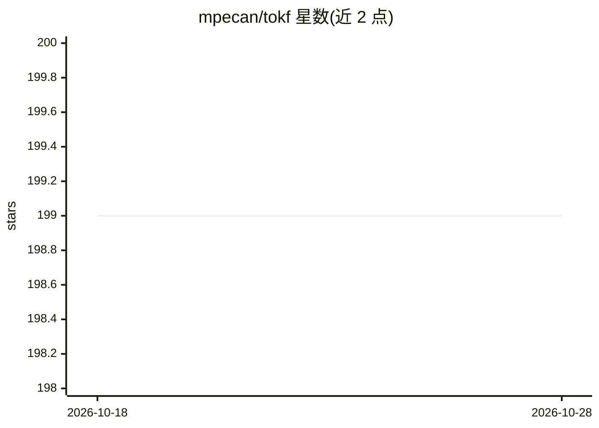

# mpecan/tokf

⭐ 199 · Rust · MIT · 推送 2026-10-24 · [GitHub](https://github.com/mpecan/tokf) · [官网](https://tokf.net) · 个人维护

**压缩 CLI 命令输出以减少 AI agent 上下文消耗的工具**

Rust 编写的配置驱动 CLI 工具：拦截 git、cargo、docker、npm 等命令输出，应用 TOML 过滤器后只输出关键信息，声称降低 60–90% 的 LLM 上下文消耗。过滤器以纯 TOML 文件定义，无需重编译即可编写、分享或覆盖；内置覆盖 git、cargo、npm、kubectl 等的过滤器库，另有 err/test/summary 三个通用压缩子命令。通过 hook 集成到 Claude Code 等 AI 编码工具实现自动过滤，支持自动包裹 make/just 逐行过滤、退出码透传与彩色输出保留。面向使用 AI 编码代理的开发者。

## 筛选速览

| 维度 | 判定 | 备注 |
|---|---|---|
| AI 角色 | `ai-ecosystem` | LLM/agent 周边工具 |
| 许可风险 | `permissive` | MIT |
| 部署形态 | `self-host` | docker 或自建部署 |
| 模型依赖 | — | README 未给出锁定关系 |
| 硬件要求 | — | 无带数字的原话,不猜 |
| 安装摩擦 | `low` | 无编译、无系统依赖或容器化 |
| 成熟度 | — | 结构信号不足 |

## 能力要点

- TOML 过滤器无需重编译，可编写、分享、覆盖（项目级/用户级 shadow 机制）
- 内置 git/cargo/docker/npm/kubectl/gradle 等过滤器库，git status 实测平均降低 24.4% token
- tokf err / test / summary 三个通用子命令处理任意命令输出
- hook 集成 AI 编码工具自动过滤，make/just 逐行包裹，退出码掩码与透传控制

## 适用场景

- 让 AI 编码代理看到的命令输出更精简，节省上下文窗口
- 从长构建日志中只提取错误与测试失败信息
- 自定义并分享团队常用命令的输出过滤规则

## 场景标签

 · 领域:开发者工具/LLM 上下文优化

## 证据(README 行号)

> L10: Commands like `git push`, `cargo test`, and `docker build` produce verbose output packed with progress bars, compil
> L90: ## Set up automatic filtering
> L92: If you use an AI coding tool, install the hook so every command is filtered automatically — no `tokf run` prefix ne

## 星数曲线

2026-10-18 199 → 2026-10-28 199（+0）

---
*卡片 v1 · prompt 1.4 · 生成 2026-10-22 · 置信度 mid · 依据 README sha `f05e7f0fb7c2` · [字段定义](../../DATASET.md)*
