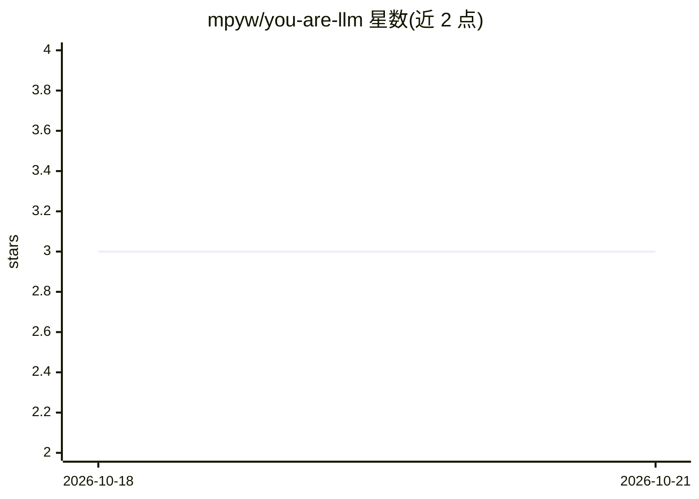

# mpyw/you-are-llm

⭐ 3 · TypeScript · 推送 2026-10-09 · [GitHub](https://github.com/mpyw/you-are-llm) · [官网](https://mpyw.me/you-are-llm/) · 个人维护

**扮演 LLM 一侧的打字练习器：逐字打出编程会话助手内容**

一个网页打字训练应用：用户扮演编程会话中的助手侧，逐块逐字打出日文假名读音、代码与 shell 命令，无自动补全。内置 614 个会话，覆盖 10 种编程语言与日/英两种自然语言，按 Easy 到 Expert+ 五档难度分级；难度由脚本按 Shift 键占比与符号形状数计算。输入引擎同时保持多种罗马字拼写（如 shi/si/ci），支持 Tab 缩进、连击统计、S-D 评级与分享功能。基于 React/TypeScript 7 构建，通过 GitHub Pages 部署；AZIK 布局尚未实现。

## 筛选速览

| 维度 | 判定 | 备注 |
|---|---|---|
| AI 角色 | `ai-enhanced` | 去掉 AI 部分产品仍成立 |
| 许可风险 | `none` | — |
| 部署形态 | `None` |  |
| 模型依赖 | — | README 未给出锁定关系 |
| 硬件要求 | — | 无带数字的原话,不猜 |
| 安装摩擦 | `low` | 无编译、无系统依赖或容器化 |
| 成熟度 | — | 结构信号不足 |

## 能力要点

- 614 个会话覆盖 10 种编程语言与日/英双语，五档难度
- 输入引擎同时保持多种罗马字拼写并按按键收敛
- 难度由脚本按 Shift 占比与符号形状数自动测量
- Web Audio 合成音效，支持 prefers-reduced-motion

## 适用场景

- 以打字方式练习日语假名输入（IME 场景）
- 练习多种编程语言的符号输入与准确率
- 按难度过滤并分享打字会话成绩

## 场景标签

 · 领域:打字训练/教育工具

## 证据(README 行号)

> L5: **You type the LLM's side of a coding session. No completion. No shortcuts.**
> L28: Pick a session, then type the assistant blocks one at a time. Every block is one run of the engine.

## 星数曲线

2026-10-18 3 → 2026-10-21 3（+0）

---
*卡片 v1 · prompt 1.4 · 生成 2026-10-18 · 置信度 mid · 依据 README sha `3f7736aa521b` · [字段定义](../../DATASET.md)*
