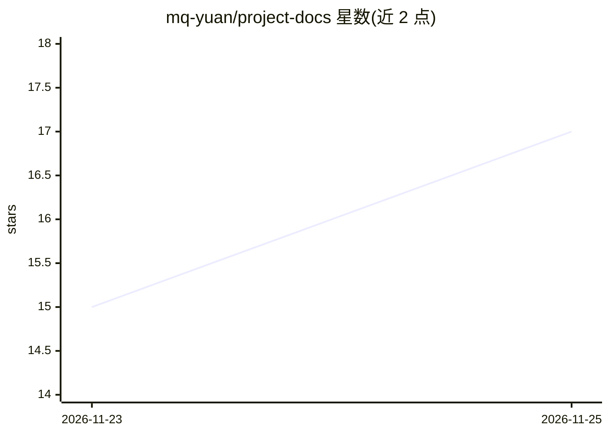

# mq-yuan/project-docs

⭐ 17 · Python · MIT · 推送 2026-11-23 · [GitHub](https://github.com/mq-yuan/project-docs) · 个人维护 · 中文 README

**为 coding agent 提供项目级记忆：以仓库文档承载项目事实并就地改写**

以 agent skill（SKILL.md）与零依赖 CLI 形式提供的项目级记忆管理方案：将接口约定、实验结论、进度与阻塞项等属于单个项目的事实写为仓库内文档并随代码演进就地改写，区别于全局 agent 记忆。附带结构化 linter 检查状态页行数、日期有效性、归档链接等规则，可作为 Claude Code PostToolUse hook 在编辑后反馈。安装支持 npx skills add 与 git clone 手动复制，CLI 需 Python 3.11+ 且未发布到 PyPI，须从 GitHub 锁定 release 运行。

## 筛选速览

| 维度 | 判定 | 备注 |
|---|---|---|
| AI 角色 | `ai-ecosystem` | LLM/agent 周边工具 |
| 许可风险 | `permissive` | MIT |
| 部署形态 | `library` | 以包/库形式分发 |
| 模型依赖 | — | README 未给出锁定关系 |
| 硬件要求 | — | 无带数字的原话,不猜 |
| 安装摩擦 | `low` | 无编译、无系统依赖或容器化 |
| 成熟度 | — | 结构信号不足 |

## 能力要点

- agent skill（SKILL.md）+ 零依赖 CLI linter 双组件结构
- 收敛后写入、就地改写、过期声明删除的文档维护规则
- 9 条结构规则（PD000-PD009）与 TOML/pyproject 配置
- Claude Code PostToolUse hook 编辑时即时校验

## 适用场景

- 让 coding agent 在项目内维护随代码演进的结论文档
- 用 linter 保证状态页与文档索引的结构一致性
- 需要替代 ADR 的按生命周期拆分的决策文档组织

## 场景标签

`Agent 记忆` · 领域:Agent 开发

## 证据(README 行号)

> L5: `project-docs` is project-level memory management: it keeps the facts that belong to one project
> L10: It ships as an agent skill (`SKILL.md`) and a `project-docs` CLI
> L11: that checks a few structural rules, also as a Claude Code hook; the skill does the main work and

## 星数曲线

2026-11-23 15 → 2026-11-25 17（+2）

---
*卡片 v1 · prompt 1.4 · 生成 2026-11-23 · 置信度 mid · 依据 README sha `bd3261116415` · [字段定义](../../DATASET.md)*
