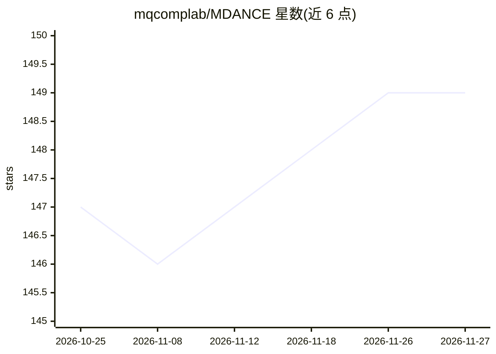

# mqcomplab/MDANCE

⭐ 149 · Python · MIT · 推送 2026-11-20 · [GitHub](https://github.com/mqcomplab/MDANCE) · [官网](https://mqcomplab.github.io/MDANCE/) · 组织维护

**面向分子动力学研究者的轨迹聚类分析工具库**

基于 n-ary（扩展）相似度的分子动力学轨迹聚类 Python 库：将全帧同时比较替代两两比较，算法随帧数线性扩展且不构建两两距离矩阵；采用确定性种子使相同输入得到相同聚类结果。提供 NANI、HELM、DIVINE、mdBIRCH、SHINE、PRISM、eQual、PRIME 八种算法，覆盖 k-means 初始化、层次聚类、在线聚类、路径分析与原生结构挑选，附示例轨迹与 scripts/ 下可直接运行的脚本。需 Python 3.10 以上，面向做结构生物学与药物发现相关模拟的研究者。

## 筛选速览

| 维度 | 判定 | 备注 |
|---|---|---|
| AI 角色 | `ai-knowledge` | 知识聚合/清单类 |
| 许可风险 | `permissive` | MIT |
| 部署形态 | `library` | 以包/库形式分发 |
| 模型依赖 | — | README 未给出锁定关系 |
| 硬件要求 | — | 无带数字的原话,不猜 |
| 安装摩擦 | `low` | 无编译、无系统依赖或容器化 |
| 成熟度 | — | 结构信号不足 |

## 能力要点

- 八种聚类算法（NANI/HELM/DIVINE/mdBIRCH/SHINE/PRISM/eQual/PRIME）覆盖从初始化到路径分析
- n-ary 相似度使成本从 O(N²) 降至 O(N)，无需两两距离矩阵
- 确定性种子：相同输入得到相同聚类结果
- 每个算法关联已发表论文并提供教程与视频

## 适用场景

- 为药物发现筛选大规模轨迹中生物学相关的构象
- 对百万帧级模拟数据做快速聚类
- 通过路径分析研究构象变化机制
- 从构象集合中挑选接近实验结构的原生构象

## 场景标签

`科研工具` · 领域:学习与行业

## 证据(README 行号)

> L3:  Molecular Dynamics Analysis with N -ary Clustering Ensembles
> L32: MDANCE is built on *n*-ary (extended) similarity, which compares all frames at once and finds high- and low-density
> L38: Researchers use MDANCE to find biologically relevant conformations for drug discovery, study mechanisms through pat

## 星数曲线

2026-10-25 147 → 2026-11-27 149（+2）

---
*卡片 v1 · prompt 1.4 · 生成 2026-11-27 · 置信度 high · 依据 README sha `ea8802a01cc5` · [字段定义](../../DATASET.md)*
