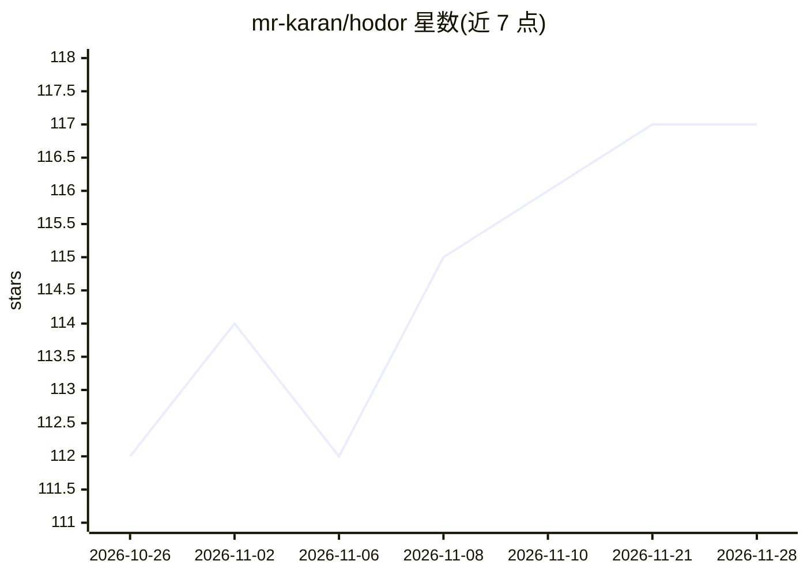

# mr-karan/hodor

⭐ 117 · TypeScript · MIT · 推送 2026-11-09 · [GitHub](https://github.com/mr-karan/hodor) · 个人维护

**面向开发者的 Agentic 代码审查工具，自动审查 PR/MR**

Hodor 是一个 Agentic 代码审查工具，支持 GitHub PR、GitLab MR、Gitea/Forgejo PR 以及本地 git diff。它检出变更后，给 LLM agent 提供受限的只读检查工具（git_diff、read、grep、find、ls），要求其产出结构化发现，并以行内评论和总结形式发布或本地打印。支持通过 AGENTS.md/CLAUDE.md 注入项目审查规范、--profile security 安全专项审查、增量审查与已修复验证、CI 指标推送（Prometheus/VictoriaMetrics）及按优先级失败退出等机制。零安装可通过 npx 直接运行，也提供 npm 全局安装与 Docker 镜像。

## 筛选速览

| 维度 | 判定 | 备注 |
|---|---|---|
| AI 角色 | `ai-native` | 本体是模型或模型工具 |
| 许可风险 | `permissive` | MIT |
| 部署形态 | `library` | 以包/库形式分发 |
| 模型依赖 | locked-api |  |
| 硬件要求 | — | 无带数字的原话,不猜 |
| 安装摩擦 | `low` | 无编译、无系统依赖或容器化 |
| 成熟度 | — | 结构信号不足 |

## 能力要点

- 支持 GitHub/GitLab/Gitea/Forgejo PR/MR 及本地 diff 审查
- LLM agent 配备只读检查工具（git_diff/read/grep/find/ls）产出结构化发现
- 支持 AGENTS.md/CLAUDE.md 项目规范加载与 security profile
- CI 指标推送（Prometheus Pushgateway/VictoriaMetrics）与 Grafana dashboard

## 适用场景

- CI 中自动审查每个 PR/MR 并行内评论
- 推送前对本地未提交变更做预审查
- 为安全专项设置独立的审查 job

## 场景标签

`代码审查` · 领域:编码与开发

## 证据(README 行号)

> L3: > Agentic code reviewer for GitHub PRs, GitLab MRs, Gitea/Forgejo PRs, and local diffs.
> L5: Hodor checks out the change, gives an LLM agent confined inspection tools (`git_diff`, `read`, `grep`, `find`, `ls`)

## 星数曲线

2026-10-26 112 → 2026-11-28 117（+5）

---
*卡片 v1 · prompt 1.4 · 生成 2026-11-28 · 置信度 high · 依据 README sha `d738e422f6f9` · [字段定义](../../DATASET.md)*
