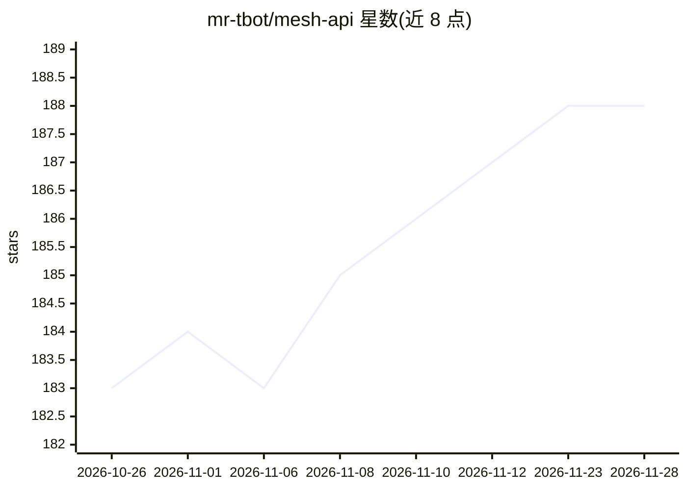

# mr-tbot/mesh-api

⭐ 188 · Python · GPL-3.0 · 推送 2026-11-15 · [GitHub](https://github.com/mr-tbot/mesh-api) · [官网](https://mesh-api.dev) · 个人维护

**连接 LoRa mesh 与 AI/API 的路由桥接器**

面向 Meshtastic 与 MeshCore LoRa mesh 的协议桥接与 API 路由服务：提供 slash 命令、AI 助手、30 个插件式扩展（通信/通知/应急天气/智能家居/网桥/AI Agent 等 7 类）、内置 MCP server 可将 mesh 功能暴露为外部 AI agent 的工具，以及 REST API 与 WebUI 仪表盘。AI 部分支持本地模型（LM Studio、Ollama）与多家云端 API 及 Home Assistant 对接，并可跨双 mesh 网络路由消息。项目由单人维护，自述处于 Beta 阶段、部分功能未经充分实地测试。

## 筛选速览

| 维度 | 判定 | 备注 |
|---|---|---|
| AI 角色 | `ai-ecosystem` | LLM/agent 周边工具 |
| 许可风险 | `viral` | GPL-3.0 |
| 部署形态 | `self-host` | docker 或自建部署 |
| 模型依赖 | local-ok | 支持本地模型 |
| 硬件要求 | — | 无带数字的原话,不猜 |
| 安装摩擦 | `low` | 无编译、无系统依赖或容器化 |
| 成熟度 | `idea` | |

## 能力要点

- 内置 MCP server，将 mesh 功能暴露为外部 AI agent 的工具（bearer-token 鉴权）
- 支持 Meshtastic、MeshCore 单独或同时接入，可做跨网路由
- 30 个内置插件式扩展，支持复制文件夹方式增删
- AI 后端支持本地模型（LM Studio/Ollama）与多家云端 API

## 适用场景

- 在没有互联网的野外场景通过 LoRa mesh 使用 AI 助手
- 将 mesh 消息转发到 Home Assistant 或 n8n 做自动化
- 紧急情况经 Twilio SMS、SMTP 与 Discord 发送带 GPS 的告警
- 在仪表盘地图查看 mesh 节点位置并与节点通信

## 场景标签

`工作流自动化` `AI 助手` `聊天机器人` · 领域:效率与自动化

## 证据(README 行号)

> L42: **MESH-API** is an experimental project that bridges Meshtastic (& now MeshCore ) LoRa mesh networks with powerful 
> L82:  - Exposes MESH-API core functions **and** extensions as MCP **tools** at `POST /mcp`, so external AI agents (Claud
> L92:  - Support for **Local** models (LM Studio, Ollama), **OpenAI**, **Claude**, **Gemini**, **Grok**, **OpenRouter**, 

## 星数曲线

2026-10-26 183 → 2026-11-28 188（+5）

---
*卡片 v1 · prompt 1.4 · 生成 2026-11-26 · 置信度 high · 依据 README sha `690f727fb207` · [字段定义](../../DATASET.md)*
