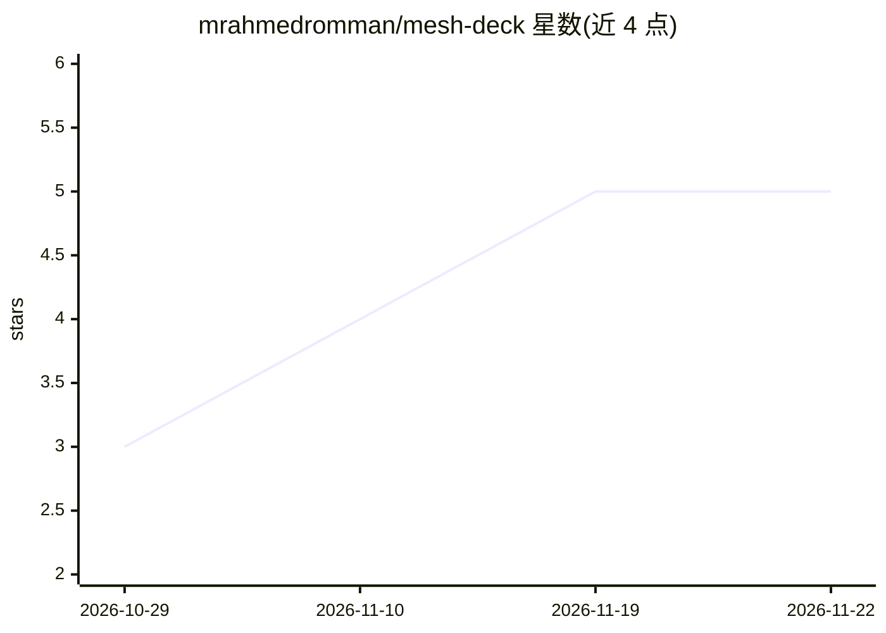

# mrahmedromman/mesh-deck

⭐ 5 · Python · MIT · 推送 2026-11-04 · [GitHub](https://github.com/mrahmedromman/mesh-deck) · [官网](https://pypi.org/project/mesh-deck/) · 个人维护

**为 NVIDIA GPU 本地 AI 服务栈做内存预检、排序启动的 CLI**

面向在一台机器上运行多个 GPU 服务（LLM、语音识别、嵌入、TTS 等）的用户：按启动顺序模拟显存占用，提前报告哪个服务装不下并给出建议的 gpu_memory_utilization 分数；依次启动并等待健康检查，每个服务独立日志，失败时报告显存持有者。读取 nvidia-smi，需 NVIDIA GPU 与 Unix-like 系统，仅在一台双 RTX 4090 Linux 机器上验证，内存检查围绕 vLLM 的分数参数构建，其他引擎需手工填 measured_mib。以 PyPI 包形式提供，Python 3.10+，MIT 许可。

## 筛选速览

| 维度 | 判定 | 备注 |
|---|---|---|
| AI 角色 | `ai-ecosystem` | LLM/agent 周边工具 |
| 许可风险 | `permissive` | MIT |
| 部署形态 | `self-host` | docker 或自建部署 |
| 模型依赖 | local-ok | 支持本地模型 |
| 硬件要求 | — | 无带数字的原话,不猜 |
| 安装摩擦 | `low` | 无编译、无系统依赖或容器化 |
| 成熟度 | `idea` | |

## 能力要点

- 启动前按顺序模拟 GPU 显存，报告不匹配的服务与建议分数
- 按序启动并等待健康检查，每个服务一份日志文件
- mesh gpu 显示每块 GPU 显存、利用率及占用者（服务/容器/桌面/其他程序）
- 仅一个 YAML 配置文件，无 daemon、无代理、不监听端口

## 适用场景

- 在一台多卡机器上同时跑 vLLM、语音识别与嵌入服务时避免显存挤爆
- 启动前预演显存分配，确定各服务的 gpu_memory_utilization 分数
- 统一管理多个本地 AI 服务的日志、状态与逆序关闭

## 场景标签

 · 领域:LLM 基础设施/本地部署编排

## 证据(README 行号)

> L17: `mesh` plans and starts a stack of local AI services on your NVIDIA GPUs, in the right order, with one log file per
> L29: If you run several GPU services on one machine (vLLM is the case this was built for), you have probably hit
> L36: - **Checks first.** Simulates GPU memory for your services in start order and tells you which will not fit,

## 星数曲线

2026-10-29 3 → 2026-11-22 5（+2）

---
*卡片 v1 · prompt 1.4 · 生成 2026-11-21 · 置信度 mid · 依据 README sha `9953faa62d4a` · [字段定义](../../DATASET.md)*
