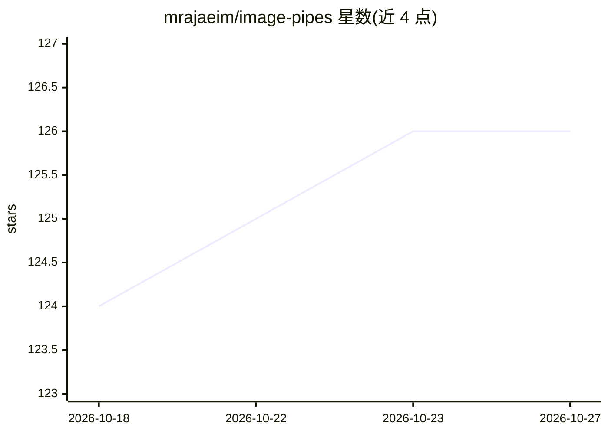

# mrajaeim/image-pipes

⭐ 126 · Python · MIT · 推送 2026-10-23 · [GitHub](https://github.com/mrajaeim/image-pipes) · 个人维护

**可视化计算机视觉流水线构建器，实时预览并导出 Python**

基于 React Flow 画布与 FastAPI 后端的桌面应用：以拖拽节点方式组装 OpenCV 与 Albumentations 图像处理/增强流水线，每个节点实时显示中间输出、边界框、掩码与关键点。执行引擎将图编译为 DAG，支持增量执行与内存缓存。可编写 Custom Python 节点（含信任门与版本化脚本），最终导出仅依赖 OpenCV/Albumentations 的独立 Python 代码。面向做数据预处理与增强实验的 ML 开发者，提供 Windows/macOS/Linux 安装包。

## 筛选速览

| 维度 | 判定 | 备注 |
|---|---|---|
| AI 角色 | `ai-enhanced` | 去掉 AI 部分产品仍成立 |
| 许可风险 | `permissive` | MIT |
| 部署形态 | `desktop` | 安装包/桌面程序 |
| 模型依赖 | — | README 未给出锁定关系 |
| 硬件要求 | — | 无带数字的原话,不猜 |
| 安装摩擦 | `medium` | 含编译或系统依赖之一 |
| 成熟度 | — | 结构信号不足 |

## 能力要点

- 拖拽节点构建流水线，每步实时预览中间输出
- OpenCV 经典 CV 与 Albumentations 增强（可传播 bbox/mask/keypoint，确定性可复现）
- DAG 编译执行：增量执行、局部重算、节点级缓存
- 导出仅依赖 OpenCV/Albumentations 的独立 Python 代码

## 适用场景

- 为 ML 训练做数据集预处理与增强并保持可复现
- 快速调参实验 OpenCV 图像变换，替代反复跑脚本
- 可视化教学或调试含边界框/掩码/关键点的标注流水线

## 场景标签

`图像视频处理` · 领域:感知与多模态

## 证据(README 行号)

> L119: **OpenCV** gives you the full classical CV toolkit:
> L245: - 🧩 ONNX Runtime and PyTorch inference nodes

## 星数曲线

2026-10-18 124 → 2026-10-27 126（+2）

---
*卡片 v1 · prompt 1.4 · 生成 2026-10-23 · 置信度 mid · 依据 README sha `16bd4b47dc99` · [字段定义](../../DATASET.md)*
