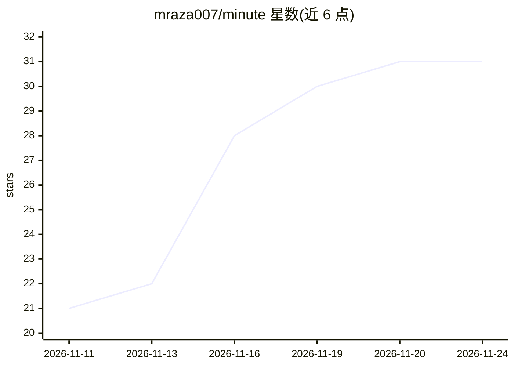

# mraza007/minute

⭐ 31 · Rust · MIT · 推送 2026-11-23 · [GitHub](https://github.com/mraza007/minute) · [官网](https://minutenotes.app) · 个人维护

**macOS 离线 AI 会议记录应用：录音、转写、摘要全在本机**

面向 Mac 用户的免费开源会议记录工具：检测 Zoom、Teams、FaceTime 等通话并提供录制，边说边转写（Whisper），录音结束后由本地语言模型生成摘要、决策与行动项，并支持基于本次转写的问答。说话人检测用两个小模型（共 34 MB）标注并保存语音档案。模型（Whisper、多款 GGUF 语言模型）从 Hugging Face 下载一次后离线运行，笔记为本地纯文件，可写入 Obsidian。限制：需 macOS 11+，Apple silicon 为测试目标，大模型需 8-16 GB 内存。

## 筛选速览

| 维度 | 判定 | 备注 |
|---|---|---|
| AI 角色 | `ai-native` | 本体是模型或模型工具 |
| 许可风险 | `permissive` | MIT |
| 部署形态 | `None` |  |
| 模型依赖 | — | README 未给出锁定关系 |
| 硬件要求 | — | 无带数字的原话,不猜 |
| 安装摩擦 | `low` | 无编译、无系统依赖或容器化 |
| 成熟度 | — | 结构信号不足 |

## 能力要点

- Whisper 本地转写 + 本地 LLM 生成摘要/决策/行动项
- 按应用规则自动检测并录制 Zoom/Teams/Webex/Slack/FaceTime/Discord 及浏览器通话
- 说话人声纹标注与语音档案（34 MB 双模型）
- 检测 Zoom/Teams 等 7 类会议应用并按规则自动录制，笔记导出为 Markdown/Obsidian

## 适用场景

- 不想把会议音频上传云端时在本机完成转写和摘要
- 会后快速回顾决策与行动项并向笔记提问
- 把会议笔记自动归档进 Obsidian 知识库

## 场景标签

`语音识别` `AI 写作` · 领域:内容生成

## 证据(README 行号)

> L5: Minute records a meeting, transcribes it while you talk, and writes the summary.
> L157: Minute uses Whisper for transcription, a language model for summaries and Ask,
> L158: and two small models for speaker detection. You download each model once. After

## 星数曲线

2026-11-11 21 → 2026-11-24 31（+10）

---
*卡片 v1 · prompt 1.4 · 生成 2026-11-18 · 置信度 high · 依据 README sha `31089fa4cc75` · [字段定义](../../DATASET.md)*
