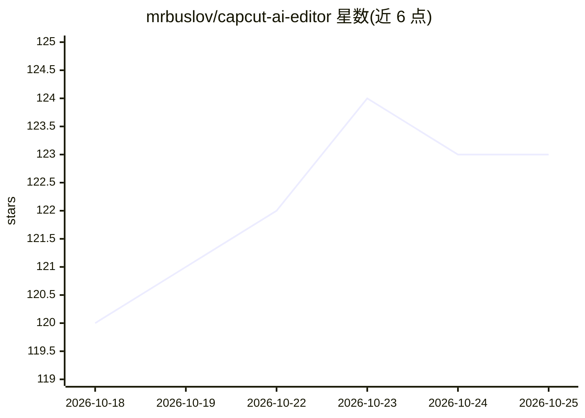

# mrbuslov/capcut-ai-editor

⭐ 123 · Python · MIT · 推送 2026-07-01 · [GitHub](https://github.com/mrbuslov/capcut-ai-editor) · 个人维护

**给视频创作者的 MCP 服务器：在剪映工程内自动去静音与重复片段**

面向 Claude Code / Claude Desktop 的 MCP 服务器，读取剪映（CapCut）自动生成的字幕文件定位语音区间，将字幕间隔超过 1 秒的静音片段切除，并按启发式规则保留重复表述的最后一次录制，修改直接写回剪映工程文件。可选配置 OPENAI_API_KEY 以启用 GPT 辅助重复检测；默认启发式分析在本地运行，无需 API key。以 Python 源码安装（pip install -e .），要求 Python 3.10+ 与已安装剪映。注意其修改工程文件时不做备份。

## 筛选速览

| 维度 | 判定 | 备注 |
|---|---|---|
| AI 角色 | `ai-ecosystem` | LLM/agent 周边工具 |
| 许可风险 | `permissive` | MIT |
| 部署形态 | `library` | 以包/库形式分发 |
| 模型依赖 | — | README 未给出锁定关系 |
| 硬件要求 | — | 无带数字的原话,不猜 |
| 安装摩擦 | `low` | 无编译、无系统依赖或容器化 |
| 成熟度 | — | 结构信号不足 |

## 能力要点

- 读取剪映自动字幕定位语音，切除 >1 秒静音片段
- 启发式检测重复表述，保留最后一版并移除先前尝试
- 默认本地启发式分析，无需 API key
- 可选 OPENAI_API_KEY 启用 GPT 辅助重复检测

## 适用场景

- 录制口播视频后让 Claude 一句话完成去静音与去重复剪辑
- 批量处理播客式谈话头视频的粗剪
- 在剪映工程内直接得到可复查的剪辑结果

## 场景标签

`图像视频处理` · 领域:感知与多模态

## 证据(README 行号)

> L3: MCP server for automated "talking head" video editing. Reads CapCut's auto-generated subtitles to find and remove si
> L10: 4. Ask Claude: "Smart cut my 'Podcast Episode 5' project"
> L36: ## Claude Code / Claude Desktop Setup

## 星数曲线

2026-10-18 120 → 2026-10-25 123（+3）

---
*卡片 v1 · prompt 1.4 · 生成 2026-10-23 · 置信度 high · 依据 README sha `b59c0c06a5ed` · [字段定义](../../DATASET.md)*
