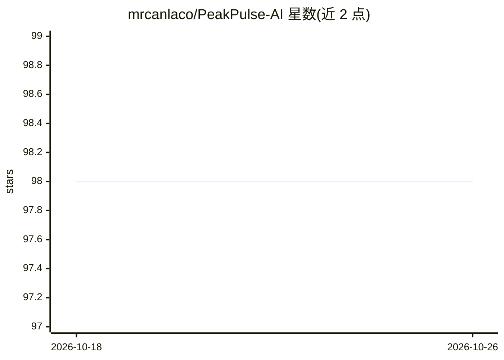

# mrcanlaco/PeakPulse-AI

⭐ 98 · Python · MIT · 推送 2026-10-02 · [GitHub](https://github.com/mrcanlaco/PeakPulse-AI) · 个人维护 · 中文 README

**金融衍生品市场的实时异常检测与时间序列 ML 引擎**

基于 Binance USD-M 永续合约公开数据（资金费率、持仓量、Taker 成交比、多空比等）的实时扫描系统：以 5 分钟周期扫描数百个交易对，运行冻结的 ML 模型输出概率预测，并带独立的异常雷达层（0-100 观察分）与 Telegram 告警。训练管线采用 Walk-Forward 验证、embargo、point-in-time as-of join 与校准，serving 端 checksum 校验失败即 fail-closed。非托管、不自动下单，遵循 Human-in-the-loop。提供 React Dashboard、Docker Compose 一键部署与 Windows 批处理启动脚本。

## 筛选速览

| 维度 | 判定 | 备注 |
|---|---|---|
| AI 角色 | `ai-native` | 本体是模型或模型工具 |
| 许可风险 | `permissive` | MIT |
| 部署形态 | `self-host` | docker 或自建部署 |
| 模型依赖 | — | README 未给出锁定关系 |
| 硬件要求 | — | 无带数字的原话,不猜 |
| 安装摩擦 | `low` | 无编译、无系统依赖或容器化 |
| 成熟度 | — | 结构信号不足 |

## 能力要点

- Walk-Forward 验证、embargo、as-of join 等反数据泄漏机制
- 冻结模型 bundle 带 SHA-256 校验与 isotonic 校准，fail-closed serving
- 24/7 扫描数百个 Binance Futures 交易对并发送 Telegram 告警
- React + Vite Web Dashboard 展示 K 线图与实时信号流

## 适用场景

- 实时监控加密衍生品市场的波动与异常信号
- 通过 Telegram 接收异常告警并在 Dashboard 查看详情
- 复用其反泄漏训练管线构建自己的金融时间序列模型

## 场景标签

`金融量化` · 领域:学习与行业

## 证据(README 行号)

> L17: Khác với các công cụ phân tích kỹ thuật truyền thống chỉ dựa vào giá đóng/mở cửa (OHLCV), **PeakPulse AI** kết hợp 
> L66: - 🔍 **Live Scanner Daemon (24/7):** Tự động quét theo thời gian thực hàng trăm cặp giao dịch Binance Futures theo c
> L71:  - Đánh giá mô hình bằng **Walk-Forward Validation**, embargo và các kiểm tra hồi quy point-in-time nhằm giảm rủi r

## 星数曲线

2026-10-18 98 → 2026-10-26 98（+0）

---
*卡片 v1 · prompt 1.4 · 生成 2026-10-23 · 置信度 high · 依据 README sha `f2c72ba0e704` · [字段定义](../../DATASET.md)*
