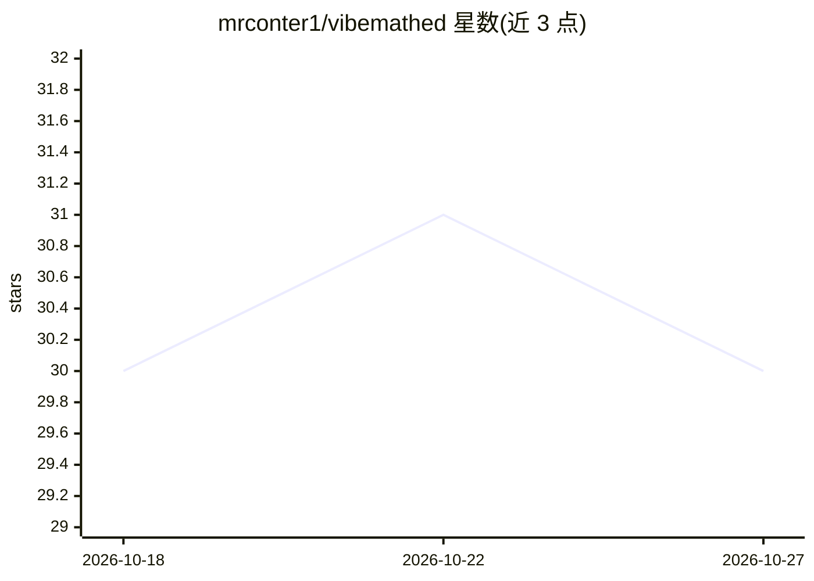

# mrconter1/vibemathed

⭐ 30 · TypeScript · MIT · 推送 2026-10-15 · [GitHub](https://github.com/mrconter1/vibemathed) · [官网](https://vibemathed.com) · 组织维护

**社区编目的 AI 解决数学问题记录库，含显著性评分与验证标签**

vibemathed.com 的源代码仓库：社区驱动的网站，追踪与编目 AI 模型（完全或部分）解决的数学问题，截至 2026 年 9 月收录 689 条条目、覆盖 12 个数学领域。每条记录包含结果状态、从 Lean 内核检验到有争议的验证阶梯、AI 贡献分级（发现/共同开发/辅助）、0-100 显著性评分及社区提交审核机制；另维护 8 个'前沿'量（如矩阵乘法指数）的最佳已知值阶梯。技术栈为 Next.js + TypeScript + CockroachDB/Prisma，数据以 CC BY 4.0 提供，代码 MIT。通过 GitHub Actions 在固定 ref 上重建外部 Lean 仓库实现 Site-confirmed 级验证。

## 筛选速览

| 维度 | 判定 | 备注 |
|---|---|---|
| AI 角色 | `ai-knowledge` | 知识聚合/清单类 |
| 许可风险 | `permissive` | MIT |
| 部署形态 | `library` | 以包/库形式分发 |
| 模型依赖 | — | README 未给出锁定关系 |
| 硬件要求 | — | 无带数字的原话,不猜 |
| 安装摩擦 | `low` | 无编译、无系统依赖或容器化 |
| 成熟度 | — | 结构信号不足 |

## 能力要点

- 689 条条目、12 个数学领域，每条引用可查证的一手来源
- 验证阶梯（Lean 内核检验至有争议）与 AI 贡献分级
- 0-100 显著性评分，锚定黎曼猜想=100，使用公开 prompt
- GitHub Actions 自动重建外部 Lean 仓库以确认证明
- 完整数据集经 API 以 CC BY 4.0 提供

## 适用场景

- 查找某数学猜想是否已被 AI 解决及其验证状态
- 追踪 AI 在具体数学量（如素数间隙）上的最佳推进
- 获取结构化的 AI 数学解题数据集用于研究

## 场景标签

`模型评测` `精选清单` · 领域:评测与运维

## 证据(README 行号)

> L3: **vibemathed.com** is a community of mathematicians
> L5: that have been solved, fully or partially, by AI models - from famous
> L9: Not a scrape, not a leaderboard. Every entry cites a real, checkable primary

## 星数曲线

2026-10-18 30 → 2026-10-27 30（+0）

---
*卡片 v1 · prompt 1.4 · 生成 2026-10-26 · 置信度 high · 依据 README sha `8224267baa4d` · [字段定义](../../DATASET.md)*
