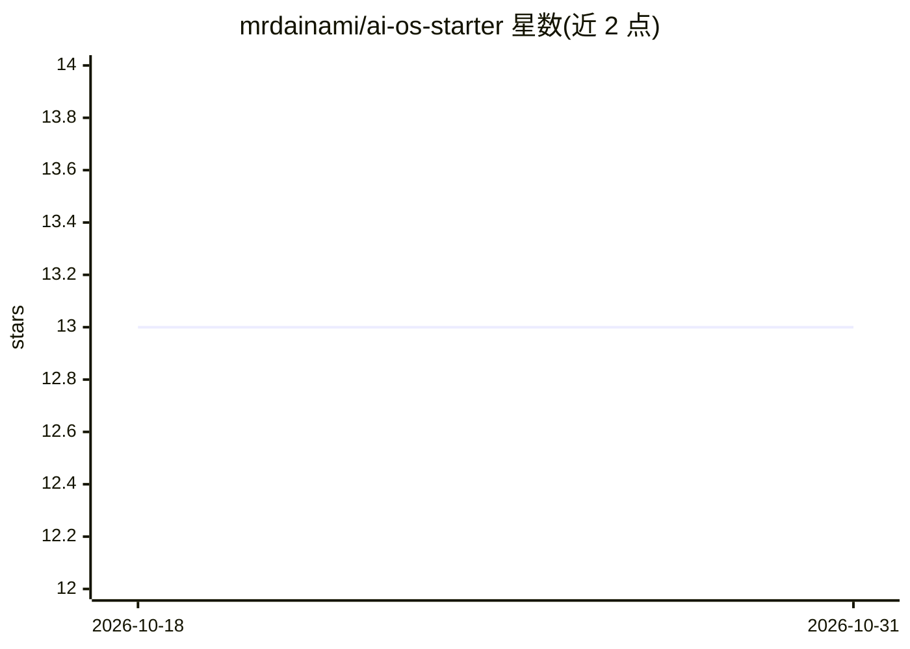

# mrdainami/ai-os-starter

⭐ 13 · MIT · 推送 2026-08-20 · [GitHub](https://github.com/mrdainami/ai-os-starter) · 组织维护

**用 AI 编程工具搭建个人 AI OS 的启动模板（FRAME 方法）**

一个刻意保持空白的文件夹模板：用 Claude Code 等 AI 编码工具打开，运行 /build-os 命令后通过问答访谈生成第一个技能，逐步搭建以纯文本文件组织的个人 AI OS。采用 FRAME 结构（Focus/Resources/Access/Make/Engine），核心设计是模型为可替换槽位，工具更换时其余文件可迁移。内置两个技能：build-os（构建/扩展 OS、经 .mcp.json 连接工具）与 obsidian-view（生成 Obsidian 可视化工作区，可选）。API key 存于 gitignored 的 .env.local。声明工具中立，Claude Code 为推荐路径，Cursor/Codex 等亦可运行。附配套视频指南与 Dainami AI 定制服务入口。

## 筛选速览

| 维度 | 判定 | 备注 |
|---|---|---|
| AI 角色 | `ai-ecosystem` | LLM/agent 周边工具 |
| 许可风险 | `permissive` | MIT |
| 部署形态 | `None` |  |
| 模型依赖 | locked-api |  |
| 硬件要求 | — | 无带数字的原话,不猜 |
| 安装摩擦 | `low` | 无编译、无系统依赖或容器化 |
| 成熟度 | — | 结构信号不足 |

## 能力要点

- FRAME 五部分结构：FOCUS.md/resources/.mcp.json/.claude/ENGINE.md
- /build-os 访谈式构建与扩展技能，经 .mcp.json 接入工具
- API key 存于 gitignored 的 .env.local，按名称引用不写明文
- 可选 /obsidian-view 生成 Obsidian 仪表盘与看板

## 适用场景

- 在 Claude Code 里运行 /build-os 逐步搭建自己的个人 AI 工作系统
- 把语音、规则等上下文做成纯文本资源供 AI 复用
- 用 Obsidian 查看和管理已建成的 OS 工作区

## 场景标签

 · 领域:个人生产力/AI 工作流模板

## 证据(README 行号)

> L3: **The folder you talk to.** A tiny starter cockpit for building your own AI OS: a system that does real work in your
> L33: > This starter is **tool-neutral**. Claude Code is what we use and what the guide is written for, but Codex, Cursor
> L100: |**M**|**Make**|The skills and agents that do the work.|`.claude/` at the cockpit root|

## 星数曲线

2026-10-18 13 → 2026-10-31 13（+0）

---
*卡片 v1 · prompt 1.4 · 生成 2026-10-31 · 置信度 high · 依据 README sha `6f9e2e1b7822` · [字段定义](../../DATASET.md)*
