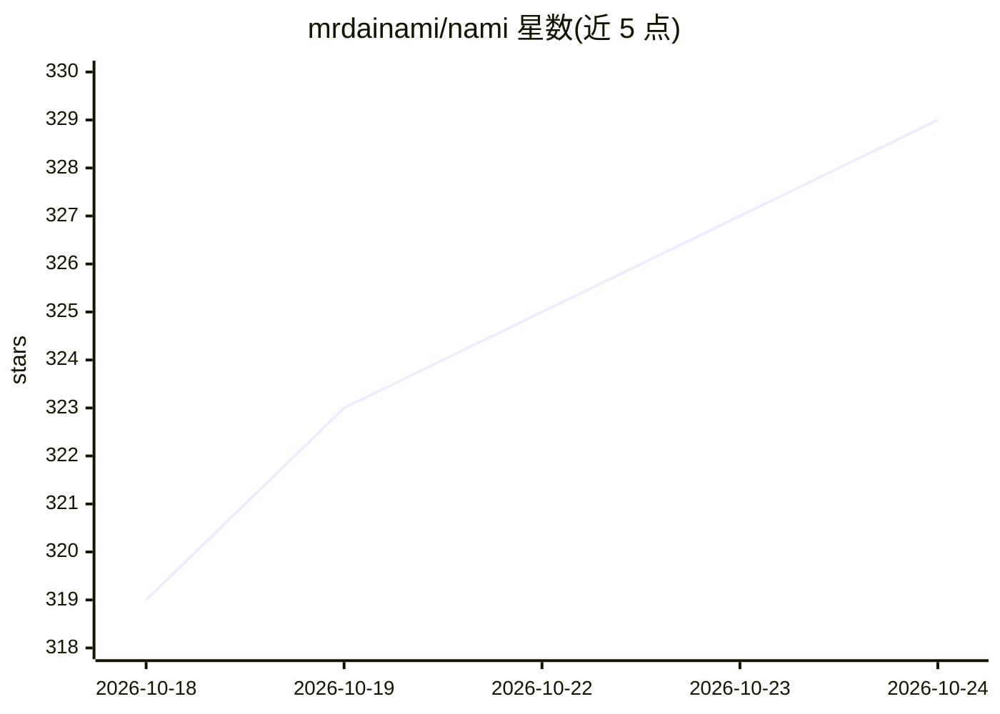

# mrdainami/nami

⭐ 330 · JavaScript · Apache-2.0 · 推送 2026-09-22 · [GitHub](https://github.com/mrdainami/nami) · [官网](https://nami.dainami.ai) · 个人维护

**桌面工作区：并排运行多个 AI agent 干活的统一操作台**

基于 Electron 的 Mac/Windows 桌面应用，提供一个工作台让 Claude Code、Codex、Gemini、OpenCode、Hermes、Kimi 等多个 AI agent 在各自窗格中同时运行；可用自然语言描述创建 agent、技能和连接（Notion/Gmail/Slack 一键接入）。使用用户已有订阅，无需 Nami 账户；仅访问用户指定的单一文件夹，听写在本地运行。Windows 上部分 agent 需另装 Git 和 Node。提供 .dmg/安装包下载，也可源码构建；由个人开发者维护，Apache 2.0 开源。

## 筛选速览

| 维度 | 判定 | 备注 |
|---|---|---|
| AI 角色 | `ai-ecosystem` | LLM/agent 周边工具 |
| 许可风险 | `permissive` | Apache-2.0 |
| 部署形态 | `desktop` | 安装包/桌面程序 |
| 模型依赖 | — | README 未给出锁定关系 |
| 硬件要求 | — | 无带数字的原话,不猜 |
| 安装摩擦 | `low` | 无编译、无系统依赖或容器化 |
| 成熟度 | — | 结构信号不足 |

## 能力要点

- 多 agent 并排在各自窗格同时运行，一键切换 agent
- 自然语言描述生成 agent、技能与连接
- 听写本地运行，仅访问指定文件夹，构建均经签名
- Mac 提供 Intel 版，Windows 提供 Arm 版

## 适用场景

- 在一个屏幕上同时让多个 AI agent 处理不同任务
- 不想为每个 agent 单独装一套工具，统一管理工作区
- 用已有订阅运行 agent，避免额外付费账户

## 场景标签

`多智能体` `编码 Agent` · 领域:Agent 开发

## 证据(README 行号)

> L23: Nami is a desk for AI agents. You open one folder on your Mac or PC, ask for something
> L31: Claude Code, Codex and Gemini ready; OpenCode, Hermes and Kimi one click away

## 星数曲线

2026-10-18 319 → 2026-10-24 329（+10）

---
*卡片 v1 · prompt 1.4 · 生成 2026-10-21 · 置信度 high · 依据 README sha `8b0c632dd9bd` · [字段定义](../../DATASET.md)*
