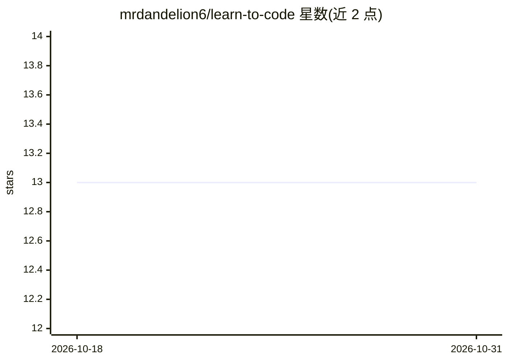

# mrdandelion6/learn-to-code

⭐ 13 · Jupyter Notebook · MIT · 推送 2026-07-09 · [GitHub](https://github.com/mrdandelion6/learn-to-code) · 个人维护

**个人编程语言与计算机科学学习笔记集合**

个人学习仓库，收录作者学习多种编程语言（C、C++、Rust、Python、R、Go、Lua 等）与计算机科学主题（数据科学、数据结构、操作系统、机器学习、并行编程等）过程中积累的笔记和代码片段。笔记按语言和主题两类组织，各条目标注进行中或已完成状态，部分笔记对应多伦多大学密西沙加分校课程（CSC209、CSC369 等）。仓库仅为阅读浏览，不提供安装或运行方式。

## 筛选速览

| 维度 | 判定 | 备注 |
|---|---|---|
| AI 角色 | `ai-knowledge` | 知识聚合/清单类 |
| 许可风险 | `permissive` | MIT |
| 部署形态 | `None` |  |
| 模型依赖 | — | README 未给出锁定关系 |
| 硬件要求 | — | 无带数字的原话,不猜 |
| 安装摩擦 | `medium` | 含编译或系统依赖之一 |
| 成熟度 | — | 结构信号不足 |

## 能力要点

- 覆盖十余种编程语言的学习笔记
- 按语言与主题两类组织，标注完成状态
- 含数据科学、机器学习、操作系统等课程主题笔记

## 适用场景

- 查阅某门语言或 CS 主题的学习笔记
- 参考 CSC 系列课程相关的学习资料

## 场景标签

`教程课程` · 领域:学习与行业

## 证据(README 行号)

> L3: Welcome to my code learning repository. This repository is a collection of my notes and code snippets as I embark on
> L6: My notes are split into 2 categories: **languages** and **topics**.

## 星数曲线

2026-10-18 13 → 2026-10-31 13（+0）

---
*卡片 v1 · prompt 1.4 · 生成 2026-10-31 · 置信度 high · 依据 README sha `aacd82d2db20` · [字段定义](../../DATASET.md)*
