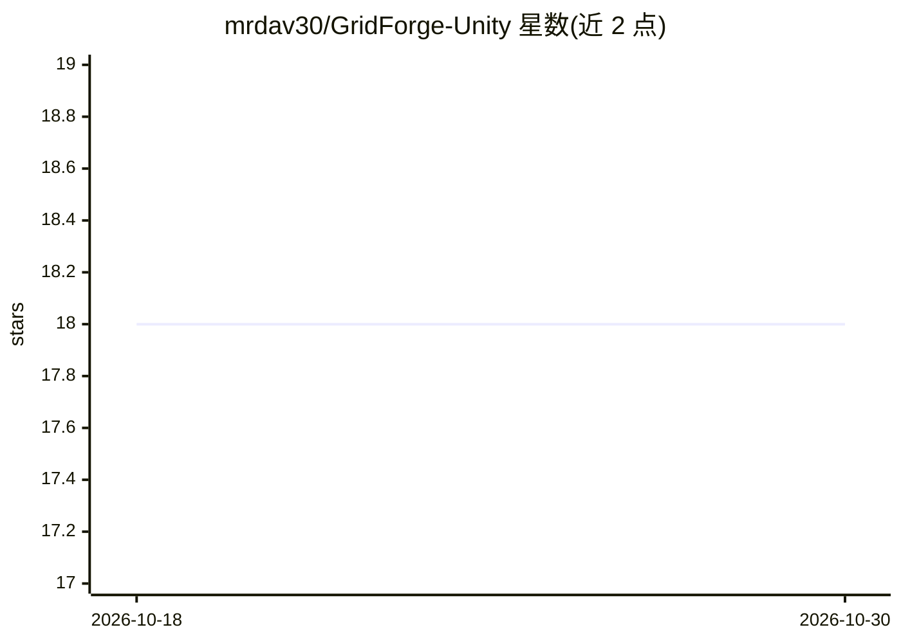

# mrdav30/GridForge-Unity

⭐ 18 · C# · MIT · 推送 2026-08-11 · [GitHub](https://github.com/mrdav30/GridForge-Unity) · 个人维护

**确定性空间网格库 GridForge 的 Unity 宿主适配包**

Unity 包，为引擎无关的确定性体素世界库 GridForge 提供宿主层：序列化配置、场景拥有的世界生命周期、Inspector 友好的矩形/六边形、稠密/稀疏网格配置，FixedMathSharp 字段序列化，阻塞体（transform/collider/renderer/手动边界）编写，诊断 gizmo 与拓扑感知可视化，以及 Demo Scene 示例。要求 Unity 2022.3+，提供 Standard（含 MemoryPack）与 Lean 两个变体，经 Package Manager 按固定 URL 从 git 安装。README 未描述任何 AI 功能。

## 筛选速览

| 维度 | 判定 | 备注 |
|---|---|---|
| AI 角色 | `ai-enhanced` | 去掉 AI 部分产品仍成立 |
| 许可风险 | `permissive` | MIT |
| 部署形态 | `None` |  |
| 模型依赖 | — | README 未给出锁定关系 |
| 硬件要求 | — | 无带数字的原话,不猜 |
| 安装摩擦 | `low` | 无编译、无系统依赖或容器化 |
| 成熟度 | — | 结构信号不足 |

## 能力要点

- 矩形/六边形、稠密/稀疏网格的 Inspector 配置编写
- FixedMathSharp 定点数学字段序列化
- 阻塞体编写与诊断 gizmo、拓扑感知可视化
- Standard（MemoryPack）与 Lean 双变体，单一选择安装

## 适用场景

- 在 Unity 场景中配置和管理确定性空间网格世界
- 为模拟或游戏编写场景级网格与阻塞体
- 通过 Demo Scene 示例学习网格工作流

## 场景标签

 · 领域:游戏开发/模拟

## 证据(README 行号)

> L10: **Scene authoring, inspectors, diagnostics, and samples for the deterministic
> L13: Keep grid behavior in the engine-agnostic core. Use this package host where

## 星数曲线

2026-10-18 18 → 2026-10-30 18（+0）

---
*卡片 v1 · prompt 1.4 · 生成 2026-10-29 · 置信度 low · 依据 README sha `1df5f5ac5f08` · [字段定义](../../DATASET.md)*
