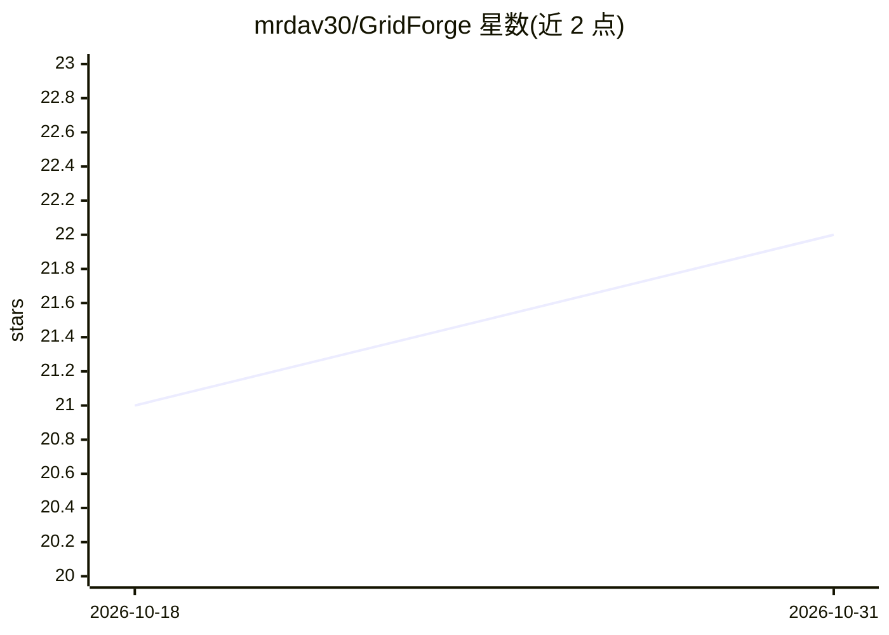

# mrdav30/GridForge

⭐ 22 · C# · MIT · 推送 2026-10-28 · [GitHub](https://github.com/mrdav30/GridForge) · 个人维护

**.NET 确定性体素网格库，用于空间划分与游戏开发**

面向 .NET 游戏与仿真的体素网格运行时库：提供 GridWorld 显式世界所有权、固定点数学（FixedMathSharp）的矩形棱柱与六棱柱网格、密集/稀疏存储、射线与边界追踪、占用者扫描、阻挡器与诊断区域等空间查询能力。核心运行时不绑定游戏引擎，Unity 的编辑与可视化在独立包 GridForge-Unity 中。通过 NuGet 提供 GridForge 与 GridForge.Lean 两种变体，目标框架为 netstandard2.1 与 net8.0。README 未展示任何 AI 模型调用或 AI 功能，仅仓库主题标签含 ai。

## 筛选速览

| 维度 | 判定 | 备注 |
|---|---|---|
| AI 角色 | `ai-enhanced` | 去掉 AI 部分产品仍成立 |
| 许可风险 | `permissive` | MIT |
| 部署形态 | `None` |  |
| 模型依赖 | — | README 未给出锁定关系 |
| 硬件要求 | — | 无带数字的原话,不猜 |
| 安装摩擦 | `medium` | 含编译或系统依赖之一 |
| 成熟度 | — | 结构信号不足 |

## 能力要点

- 固定点数学保证确定性空间运算
- 多网格拼接、矩形与六边形拓扑混合、密集/稀疏存储
- 射线追踪、占用者扫描、阻挡器与脏区域诊断内建
- 引擎无关设计，Unity 支持位于独立包

## 适用场景

- 为 Unity 或自研引擎构建确定性体素世界与空间查询
- 锁步联机模拟中做可复现的空间划分
- 大型稀疏地址空间中管理选定体素单元

## 场景标签

 · 领域:游戏开发/空间计算

## 证据(README 行号)

> L12: **Deterministic voxel worlds for .NET games, simulations, tools, and server
> L16: streamable multi-grid spaces, spatial queries, blockers, occupants, and

## 星数曲线

2026-10-18 21 → 2026-10-31 22（+1）

---
*卡片 v1 · prompt 1.4 · 生成 2026-10-28 · 置信度 low · 依据 README sha `ced6fe04312f` · [字段定义](../../DATASET.md)*
