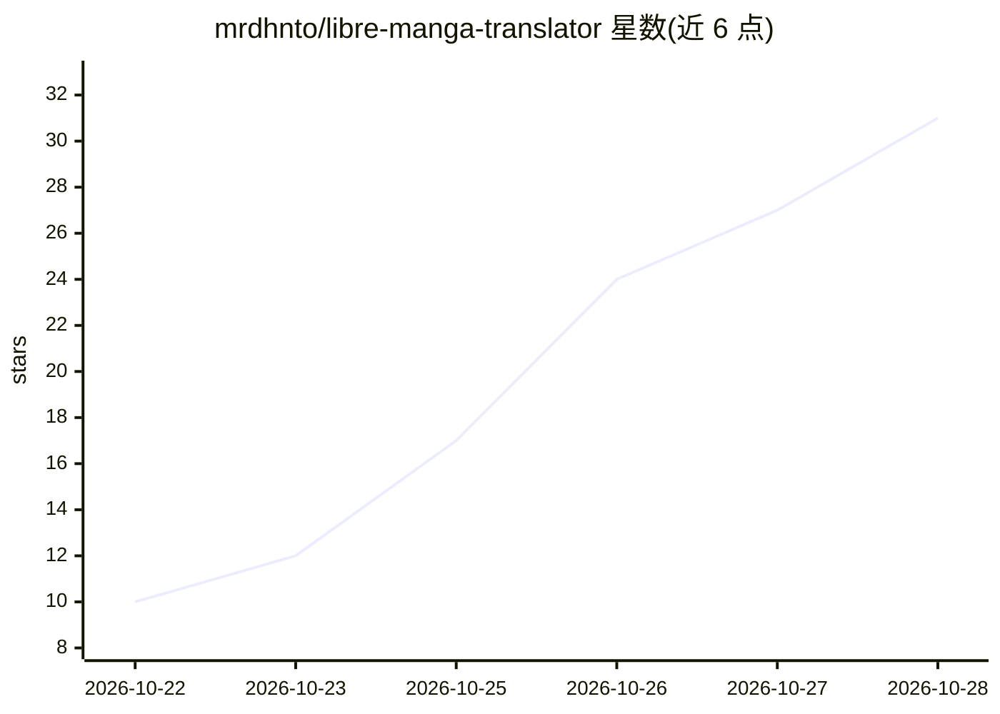

# mrdhnto/libre-manga-translator

⭐ 32 · TypeScript · NOASSERTION · 推送 2026-10-26 · [GitHub](https://github.com/mrdhnto/libre-manga-translator) · [官网](https://libre.mangatl.asia) · 个人维护

**浏览器内本地/云端漫画翻译扩展：气泡检测+OCR+翻译+嵌字**

面向漫画读者的浏览器扩展（Firefox/Chrome），在页面内完成整条翻译流水线：气泡检测（RT-DETR/CTD）、脚本门控、多引擎 OCR（Paddle/PP-OCRv6/Manga-OCR/Porroo）、多级修补（Fast ladder/神经 LaMa）与排版渲染。翻译后端三选一：全程本地的 WebLLM（Llama-3.2/Qwen3.5）、Google Gemini 云端（发送整页图像、跳过 OCR 与脚本门）、或自托管 LLM（Ollama/LM Studio 等，仅发送 OCR 文本）。本地模式在 WebGPU 可用时用 GPU，否则 WASM CPU。基于 Svelte 5，为 Local-Manga-Translator 概念验证的重写演进版。

## 筛选速览

| 维度 | 判定 | 备注 |
|---|---|---|
| AI 角色 | `ai-native` | 本体是模型或模型工具 |
| 许可风险 | `none` | NOASSERTION |
| 部署形态 | `None` |  |
| 模型依赖 | local-ok | 支持本地模型 |
| 硬件要求 | — | 无带数字的原话,不猜 |
| 安装摩擦 | `low` | 无编译、无系统依赖或容器化 |
| 成熟度 | — | 结构信号不足 |

## 能力要点

- 气泡检测、OCR、翻译、修补、排版全流程在浏览器内完成
- 三种翻译后端：本地 WebLLM / Gemini 云端 / 自托管 OpenAI 兼容服务
- 4 种 OCR 引擎可选，含面向日漫竖排文字的 Manga-OCR
- Fast ladder 与神经 LaMa 两级修补，支持自定义字体与原图对照

## 适用场景

- 在浏览器中直接翻译在线漫画页面并导出成品图
- 选择完全离线的本地翻译，不上传任何数据
- 把已自托管的 LLM 服务（Ollama/LM Studio）用作翻译后端

## 场景标签

`OCR` `图像视频处理` · 领域:感知与多模态

## 证据(README 行号)

> L21: **Local Mode** (default, fully local) runs everything on-device. A WebLLM model (Llama-3.2-1B, Qwen3.5-0.8B, Qwen3.
> L89: 1. **Bubble Detection** — RT-DETR or ComicTextDetector scans the manga page on-device inside an isolated offscreen 
> L92: 4. **Translation Routing** — Text routes to your selected backend: 100% on-device Local mode (WebLLM Llama-3.2 / Qw

## 星数曲线

2026-10-22 10 → 2026-10-28 31（+21）

---
*卡片 v1 · prompt 1.4 · 生成 2026-10-27 · 置信度 high · 依据 README sha `6786b9a986bd` · [字段定义](../../DATASET.md)*
