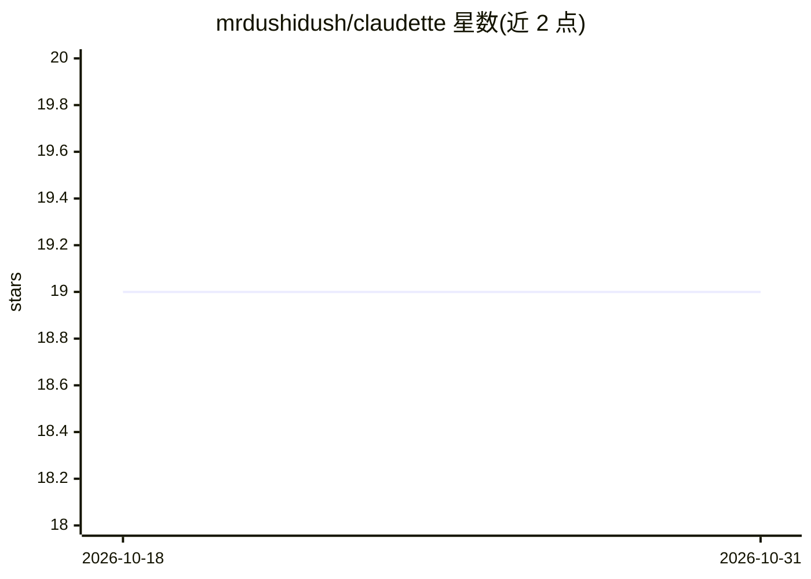

# mrdushidush/claudette

⭐ 19 · Rust · Apache-2.0 · 推送 2026-10-30 · [GitHub](https://github.com/mrdushidush/claudette) · [官网](https://github.com/mrdushidush/claudette) · 个人维护

**单文件 Rust 离线 AI 编程代理，驱动本地模型**

以单一 Rust 二进制分发的 AI 编程代理，通过 Ollama 或 LM Studio 驱动用户本地运行的模型，二进制内无云端调用代码。提供 --offline 模式（双层防护，拦截除本地模型服务器与回环外的所有出站调用，bash 工具整体禁用，并由集成测试验证）。内置 Q56 隐藏测试基准，用 cargo test/pytest/node 判定，无 LLM 评审。功能含 REPL、深度研究审计、Telegram 助手、VS Code 扩展；80+ 工具分 20 组按需启用，逐工具权限控制。无 GPU 时 4B 模型可跑 CPU。

## 筛选速览

| 维度 | 判定 | 备注 |
|---|---|---|
| AI 角色 | `ai-native` | 本体是模型或模型工具 |
| 许可风险 | `permissive` | Apache-2.0 |
| 部署形态 | `library` | 以包/库形式分发 |
| 模型依赖 | local-ok | 支持本地模型 |
| 硬件要求 | `cpu-ok` | |
| 安装摩擦 | `medium` | 含编译或系统依赖之一 |
| 成熟度 | — | 结构信号不足 |

## 能力要点

- --offline 气隙模式由集成测试强制执行，bash 工具整体禁用
- Q56 隐藏测试基准：16 种模型配置、36 次完整运行、无 LLM 评审
- 80+ 工具分 20 组按需启用，基础 schema 保持约 200 tokens
- 逐工具权限：bash/edit_file/git push 每次经 [y/N] 确认

## 适用场景

- 在无外网环境用本地模型做代码编辑与提交
- 对比选择适合自己显存的本地编程模型
- 对仓库做无人值守的只读审计并生成报告

## 场景标签

`编码 Agent` `模型评测` · 领域:编码与开发

## 证据(README 行号)

> L3: **An air-gapped AI coding agent in one Rust binary - run it `--offline` and your code physically cannot leave the ma
> L5: It also ships **Q56** - a hidden-test benchmark that measures which local model is actually worth running, with no L

## 星数曲线

2026-10-18 19 → 2026-10-31 19（+0）

---
*卡片 v1 · prompt 1.4 · 生成 2026-10-28 · 置信度 high · 依据 README sha `c7af83f902ea` · [字段定义](../../DATASET.md)*
