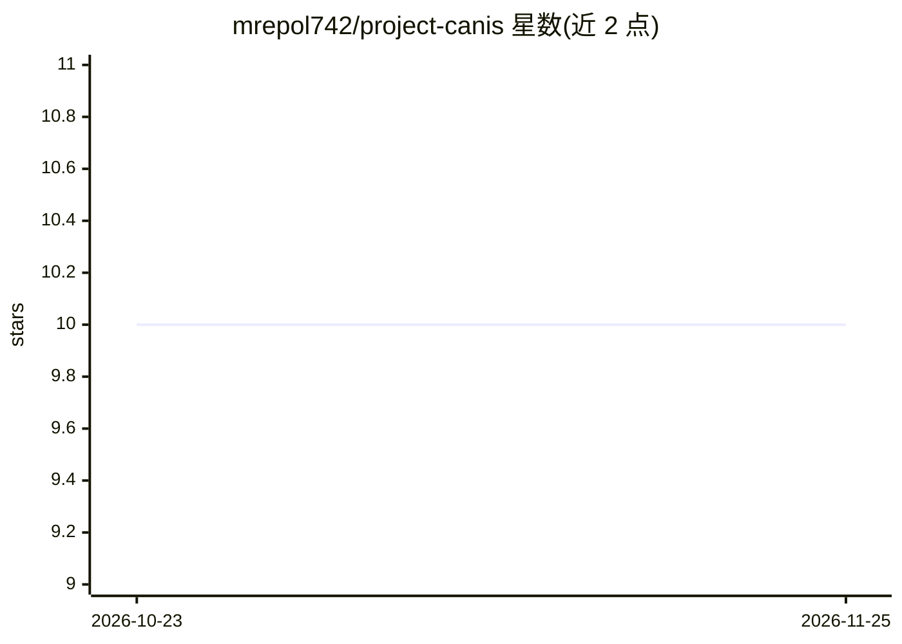

# mrepol742/project-canis

⭐ 10 · TypeScript · Apache-2.0 · 推送 2026-08-11 · [GitHub](https://github.com/mrepol742/project-canis) · [官网](https://www.melvinjonesrepol.com/canis-agent) · 个人维护

**多账号 WhatsApp 机器人：群命令、媒体下载与 Agent AI**

TypeScript 编写的 WhatsApp 机器人，可同时连接多个 WhatsApp 账号，后端使用 MariaDB、Redis 与沙盒 shell 环境，命令系统支持热重载（新增文件即扩展）。功能覆盖群组命令、多平台视频即时下载、消息自动回应/重发、来电拒接，并集成 Phishtank 与 VirusTotal 做链接安全检查、Sentry 做错误监控。AI 部分为 Agent，可搜索网络、编写并运行代码、回传文件，开箱支持 5 家 AI 提供商。README 标注仅用于教育与娱乐，账号有被封风险。

## 筛选速览

| 维度 | 判定 | 备注 |
|---|---|---|
| AI 角色 | `ai-enhanced` | 去掉 AI 部分产品仍成立 |
| 许可风险 | `permissive` | Apache-2.0 |
| 部署形态 | `library` | 以包/库形式分发 |
| 模型依赖 | local-ok | 支持本地模型 |
| 硬件要求 | — | 无带数字的原话,不猜 |
| 安装摩擦 | `medium` | 含编译或系统依赖之一 |
| 成熟度 | — | 结构信号不足 |

## 能力要点

- 多 WhatsApp 账号同时连接，基于 MariaDB/Redis/沙盒 shell
- Agent AI 可搜索网络、编写并运行代码、回传文件
- 支持 OpenRouter/OpenAI/Groq/Gemini/Ollama 共 5 家提供商
- 命令系统热重载，命令与 Telegram 版互通

## 适用场景

- 在 WhatsApp 群里通过消息下载各平台视频
- 用聊天消息让 AI 搜索网络、写代码并返回结果
- 管理多个 WhatsApp 账号并运行群组娱乐命令
- 通过 Phishtank/VirusTotal 集成检查群内链接

## 场景标签

`聊天机器人` · 领域:对话与助手

## 证据(README 行号)

> L3: A multi-account WhatsApp bot built in TypeScript that handles everything from group commands and instant media downl
> L13: ## Supported AI Providers
> L30: - Instant Download of Videos from supported platform

## 星数曲线

2026-10-23 10 → 2026-11-25 10（+0）

---
*卡片 v1 · prompt 1.4 · 生成 2026-11-19 · 置信度 high · 依据 README sha `4f3394664a3b` · [字段定义](../../DATASET.md)*
