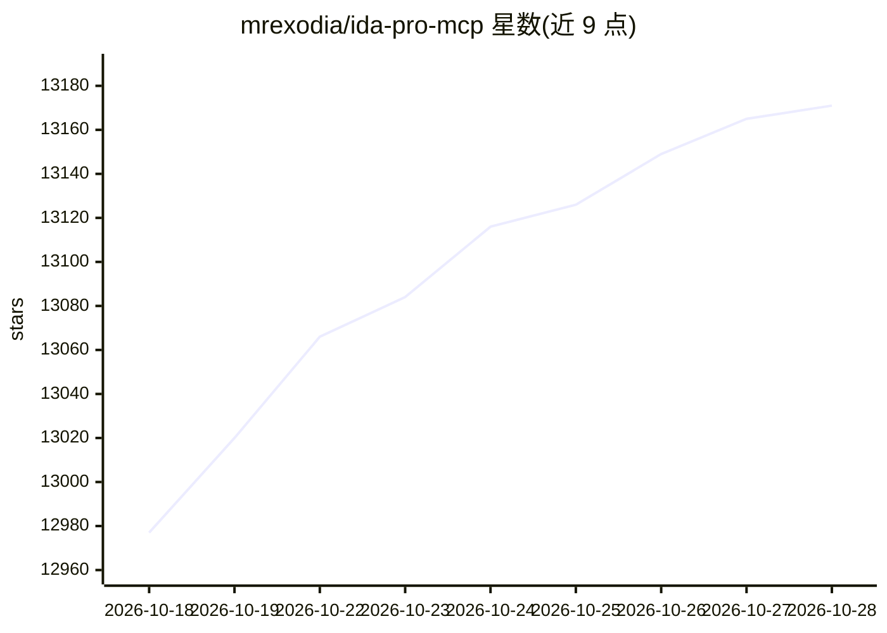

# mrexodia/ida-pro-mcp

⭐ 13,171 · Python · MIT · 推送 2026-09-26 · [GitHub](https://github.com/mrexodia/ida-pro-mcp) · [官网](https://plugins.hex-rays.com/mrexodia/ida-pro-mcp) · 个人维护

**连接 IDA Pro 与 LLM 的 MCP 服务器，辅助逆向分析**

通过 Model Context Protocol 将 IDA Pro 的反编译、反汇编、交叉引用、类型/结构操作、内存读取等能力暴露给 MCP 客户端（Claude Code、Codex、Cursor 等 20 余种），使语言模型能在逆向工程中查询与修改 IDB。提供 GUI 插件方式与基于 idalib 的无头模式：supervisor 管理持久化的数据库 worker 进程，支持多会话、SSE/stdio 传输。前置要求 Python 3.11+、IDA Pro 8.3+（IDA Free 不支持）。README 顶部声明推荐改用 Hex-Rays 官方 MCP Server，GUI 插件路径将逐步弃用。

## 筛选速览

| 维度 | 判定 | 备注 |
|---|---|---|
| AI 角色 | `ai-ecosystem` | LLM/agent 周边工具 |
| 许可风险 | `permissive` | MIT |
| 部署形态 | `desktop` | 安装包/桌面程序 |
| 模型依赖 | — | README 未给出锁定关系 |
| 硬件要求 | — | 无带数字的原话,不猜 |
| 安装摩擦 | `low` | 无编译、无系统依赖或容器化 |
| 成熟度 | — | 结构信号不足 |

## 能力要点

- 以 MCP 工具形式暴露反编译/反汇编/交叉引用/打补丁等 IDA 操作
- idalib 无头模式：持久化 worker 进程、多数据库会话管理与热采纳
- 支持 SSE 与 stdio 传输，兼容 20 余种 MCP 客户端
- 提供 MCP Resources 只读浏览 IDB 元数据、段、类型与结构

## 适用场景

- 让 Claude Code/Codex 等 AI 客户端直接查询和注释 IDA 中的二进制
- 无头环境下批量分析多个二进制文件
- 在逆向工作流中用自然语言驱动反编译与补丁操作

## 场景标签

`网络安全` · 领域:学习与行业

## 证据(README 行号)

> L8: Simple MCP Server to allow vibe reversing in IDA Pro.
> L19: - Supported MCP Client (pick one you like)
> L155: After installing `idalib` you can also run a headless MCP server. You can start with an initial binary:

## 星数曲线

2026-10-18 12,977 → 2026-10-28 13,171（+194）

---
*卡片 v1 · prompt 1.4 · 生成 2026-10-20 · 置信度 mid · 依据 README sha `4ad54eed115c` · [字段定义](../../DATASET.md)*
