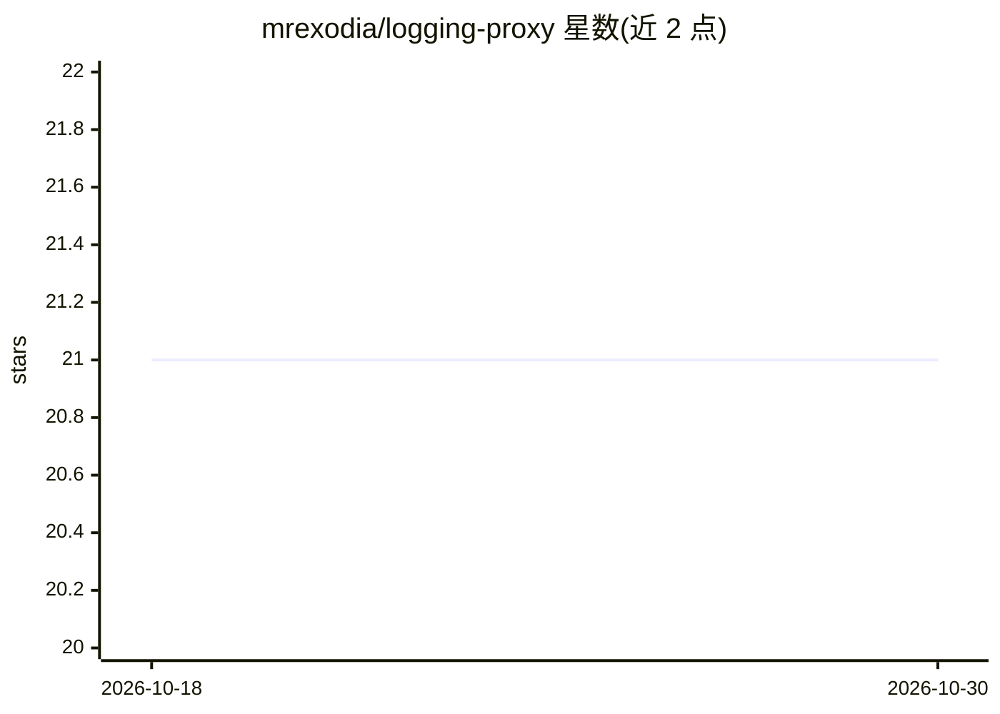

# mrexodia/logging-proxy

⭐ 21 · Go · 推送 2026-09-08 · [GitHub](https://github.com/mrexodia/logging-proxy) · 个人维护

**记录 LLM 流量的反向/正向代理，附只读 Web 查看器**

Go 编写的 HTTP 代理工具：同一二进制可启动基于路由规则的反向代理与支持 MITM 解密 HTTPS 的正向代理，完整捕获请求/响应（含 WebSocket 帧、SSE 事件）到 .bin 与 JSONL 日志。路由可注入/校验后端 API 凭证（如 OpenRouter key），支持上游 SOCKS 代理、include/exclude 主机过滤。另提供只读 Web UI 与 GET HTTP API，用于实时检索、分页浏览与下载历史流量；仅接受 loopback 监听地址。通过 go run 源码运行，含 Windows 独立构建命令与旧格式元数据迁移脚本。

## 筛选速览

| 维度 | 判定 | 备注 |
|---|---|---|
| AI 角色 | `ai-ecosystem` | LLM/agent 周边工具 |
| 许可风险 | `none` | — |
| 部署形态 | `desktop` | 安装包/桌面程序 |
| 模型依赖 | — | README 未给出锁定关系 |
| 硬件要求 | — | 无带数字的原话,不猜 |
| 安装摩擦 | `low` | 无编译、无系统依赖或容器化 |
| 成熟度 | — | 结构信号不足 |

## 能力要点

- 反向代理 + 正向代理双监听，MITM 解密记录 HTTPS 请求/响应体
- 路由级凭证注入与客户端凭证校验（backend_key/client_key）
- 只读 Web UI：实时请求流、SSE/WebSocket 帧检查、原始文件下载
- GET 只读 HTTP API 提供历史检索、文件分页下载与 SSE tail

## 适用场景

- 调试 LLM API 调用时查看完整请求与响应内容
- 记录并审计通过代理的第三方 API 流量
- 检查客户端的 SSE 流与 WebSocket 通信内容

## 场景标签

`LLM 可观测性` · 领域:评测与运维

## 证据(README 行号)

> L3: HTTP proxy tooling for capturing full request/response traffic.
> L33:   openrouter:

## 星数曲线

2026-10-18 21 → 2026-10-30 21（+0）

---
*卡片 v1 · prompt 1.4 · 生成 2026-10-28 · 置信度 mid · 依据 README sha `b18016a7821f` · [字段定义](../../DATASET.md)*
