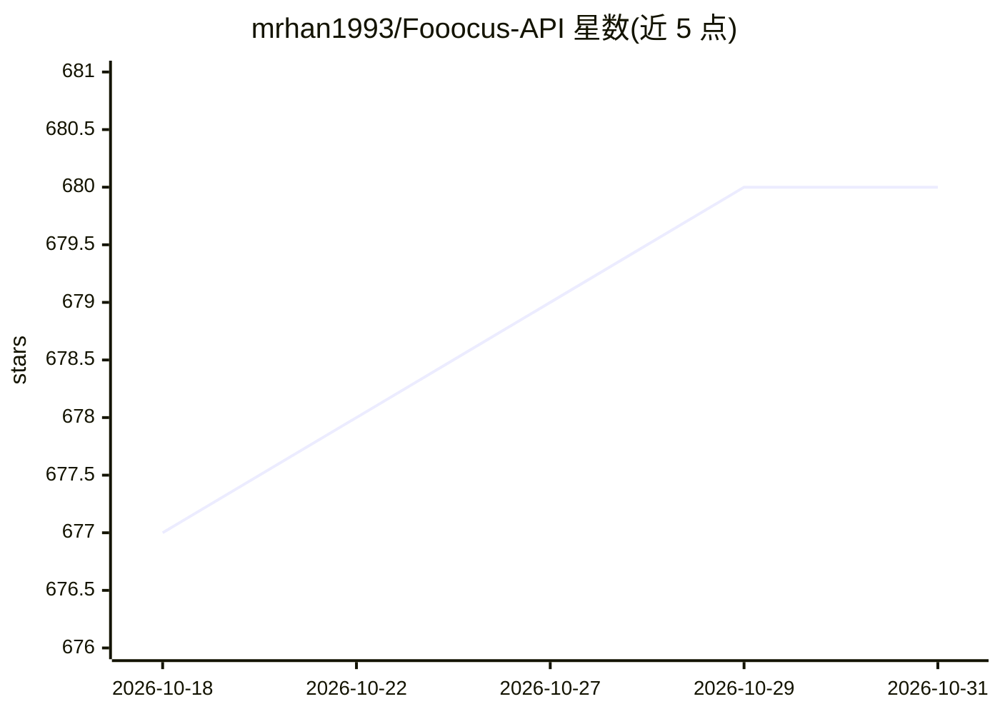

# mrhan1993/Fooocus-API

⭐ 680 · Python · GPL-3.0 · 推送 2026-08-04 · [GitHub](https://github.com/mrhan1993/Fooocus-API) · 个人维护 · 中文 README

**为 Fooocus 图像生成软件提供 REST API 服务**

基于 FastAPI 封装 Fooocus（Gradio 图像生成软件，当前内置 2.3.0 版本）的项目，将文生图、图像增强、Upscale/Vary 等能力以 REST API 暴露，供任意编程语言调用，并提供文档与示例代码。支持 Replicate 托管模型或本地部署：conda/venv 环境下运行 main.py，首次启动自动完成依赖安装与模型下载；也提供含 GPU 支持的 Docker 镜像。命令行参数含队列管理、webhook 通知、历史持久化与 API key 鉴权；远程 URL 输入仅允许公网地址。GPL-3.0 许可。

## 筛选速览

| 维度 | 判定 | 备注 |
|---|---|---|
| AI 角色 | `ai-ecosystem` | LLM/agent 周边工具 |
| 许可风险 | `viral` | GPL-3.0 |
| 部署形态 | `self-host` | docker 或自建部署 |
| 模型依赖 | — | README 未给出锁定关系 |
| 硬件要求 | — | 无带数字的原话,不猜 |
| 安装摩擦 | `low` | 无编译、无系统依赖或容器化 |
| 成熟度 | — | 结构信号不足 |

## 能力要点

- 以 FastAPI 封装 Fooocus，提供 REST API 与示例代码
- 支持 Replicate 托管或 conda/venv/Docker 自部署
- 命令行参数提供队列、webhook、历史持久化与 API key 鉴权
- ImageEnhance 接口支持最多 3 个控制器与 Upscale/Vary 前后处理

## 适用场景

- 用任意语言调用 Fooocus 的图像生成与增强能力
- 自托管带 GPU 的文生图 API 服务供应用集成
- 复用已安装的 Fooocus 模型同时运行 Fooocus 与 API 服务

## 场景标签

`图像生成` · 领域:内容生成

## 证据(README 行号)

> L44: FastAPI powered API for Fooocus.
> L66: Fooocus API uses FastAPI provides the `REST` API for using Fooocus. Now, you can use Fooocus's powerful ability in 

## 星数曲线

2026-10-18 677 → 2026-10-31 680（+3）

---
*卡片 v1 · prompt 1.4 · 生成 2026-10-21 · 置信度 high · 依据 README sha `65ce40b81501` · [字段定义](../../DATASET.md)*
