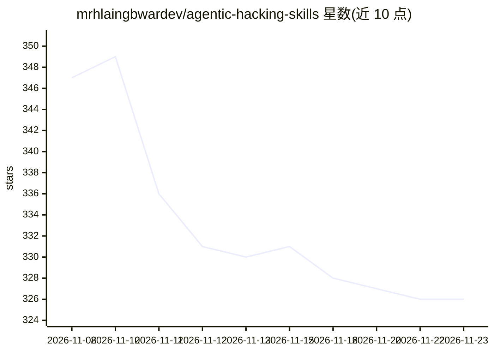

# mrhlaingbwardev/agentic-hacking-skills

⭐ 326 · JavaScript · NOASSERTION · 推送 2026-11-01 · [GitHub](https://github.com/mrhlaingbwardev/agentic-hacking-skills) · 个人维护 · 中文 README

**《Agentic Hacking》电子书配套的 agent 技能与 MCP 配置合集**

《Agentic Hacking》电子书的官方 bonus 仓库，提供 28 个 SKILL.md 模板、web-pentest agent、自定义 wsl-security-tools MCP server 与 opencode.jsonc 配置，供 OpenCode 使用。安装方式为让 AI 按 repo 链接自动下载放入对应目录，或手动 git clone 后复制到 ~/.config/opencode 各子目录并替换占位 API key。README 建议选用轻量低 reasoning 的模型（如 DeepSeek Flash）以减少安全请求被拒绝，并声明仅用于授权测试。

## 筛选速览

| 维度 | 判定 | 备注 |
|---|---|---|
| AI 角色 | `ai-knowledge` | 知识聚合/清单类 |
| 许可风险 | `none` | NOASSERTION |
| 部署形态 | `None` |  |
| 模型依赖 | — | README 未给出锁定关系 |
| 硬件要求 | — | 无带数字的原话,不猜 |
| 安装摩擦 | `low` | 无编译、无系统依赖或容器化 |
| 成熟度 | — | 结构信号不足 |

## 能力要点

- 28 个 SKILL.md 技能模板
- web-pentest agent 与自定义 wsl-security-tools MCP server
- 提供 Linux/macOS/WSL 与 Windows PowerShell 手动安装脚本

## 适用场景

- 为 OpenCode 添加 Web 渗透测试技能与 agent
- 配合《Agentic Hacking》电子书实践安全自动化
- 复用 MCP server 配置接入安全工具

## 场景标签

`网络安全` · 领域:学习与行业

## 证据(README 行号)

> L41: |`skills/`|SKILL.md templates ၂၈ ခု|
> L7: > **AI-Powered Web Security & Automation** — Official Bonus Repository

## 星数曲线

2026-11-08 347 → 2026-11-23 326（-21）

---
*卡片 v1 · prompt 1.4 · 生成 2026-11-17 · 置信度 high · 依据 README sha `9ffedbed3f67` · [字段定义](../../DATASET.md)*
