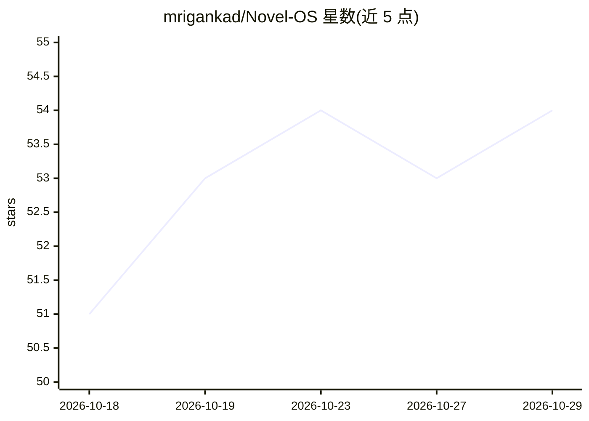

# mrigankad/Novel-OS

⭐ 54 · Python · MIT · 推送 2026-08-09 · [GitHub](https://github.com/mrigankad/Novel-OS) · 个人维护

**多智能体小说写作工作室：持久故事状态+连续性检查**

面向长篇小说创作的写作工作室：五个专职 agent（Architect/Scribe/Editor/Guardian/Curator）按章节流水线协作，所有结构化输出解析并合并进中央 story_state.json，形成跨章节持久记忆。内置确定性的免费连续性引擎（休眠线索、未回收伏笔、时间线漂移、中段松弛等检查）在 LLM Guardian 之前运行，每条发现可用『This is intentional』豁免。LLM 层支持 Anthropic/OpenAI/Gemini/DeepSeek/Ollama 等十余种提供方及任意 OpenAI 兼容端点。提供 CLI 与浏览器 Studio（后端 API+React 应用）两种使用方式。

## 筛选速览

| 维度 | 判定 | 备注 |
|---|---|---|
| AI 角色 | `ai-native` | 本体是模型或模型工具 |
| 许可风险 | `permissive` | MIT |
| 部署形态 | `library` | 以包/库形式分发 |
| 模型依赖 | local-ok | 支持本地模型 |
| 硬件要求 | — | 无带数字的原话,不猜 |
| 安装摩擦 | `low` | 无编译、无系统依赖或容器化 |
| 成熟度 | — | 结构信号不足 |

## 能力要点

- 五 agent 编辑流水线（策划/起草/编辑/校验/文风）
- agent 输出合并进 story_state.json 的持久故事状态
- 确定性连续性引擎：休眠线索、未回收伏笔、中段松弛等检查，先于 LLM 运行
- LLM 提供方可切换，含 Ollama/LM Studio 本地模型与任意 OpenAI 兼容端点

## 适用场景

- 用 AI agent 流水线起草并修订长篇小说
- 在修订时检查伏笔、线索与时间线的连续性
- 用本地模型或自有订阅（如 Claude Code CLI）运行写作流水线

## 场景标签

`多智能体` `AI 写作` · 领域:Agent 开发

## 证据(README 行号)

> L23: **Novel OS** is a complete **editorial infrastructure** for producing professional-quality novels using multiple sp
> L28: - 🤝 **Agents collaborate** Architect → Scribe → Editor → Guardian → Curator, each handing off to the next with full

## 星数曲线

2026-10-18 51 → 2026-10-29 54（+3）

---
*卡片 v1 · prompt 1.4 · 生成 2026-10-24 · 置信度 mid · 依据 README sha `6287e7100b3e` · [字段定义](../../DATASET.md)*
