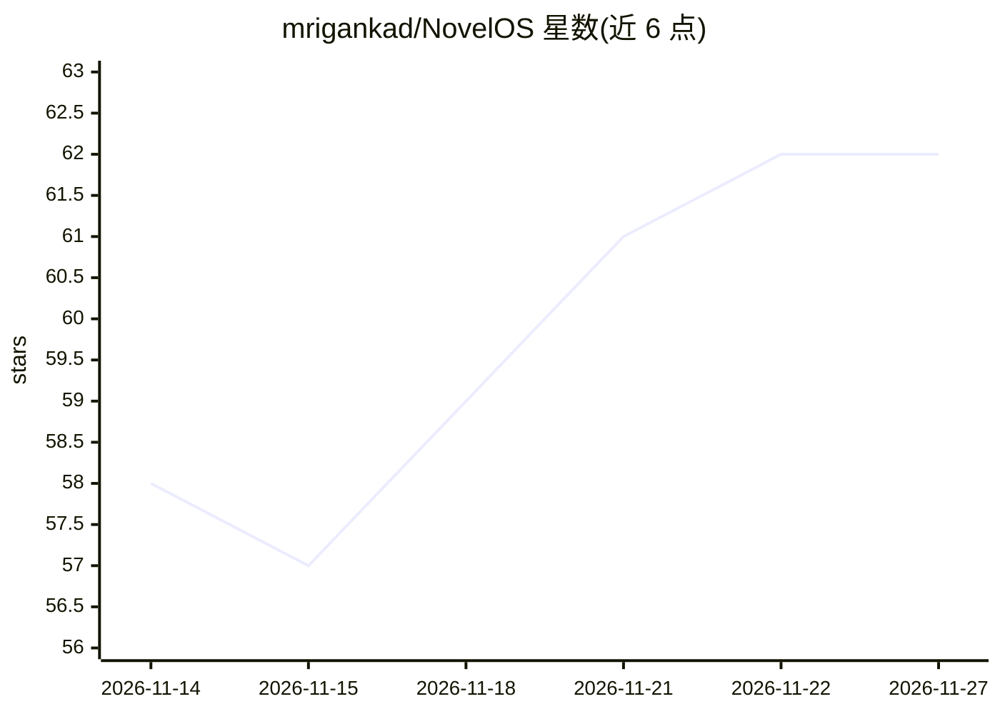

# mrigankad/NovelOS

⭐ 62 · Python · AGPL-3.0 · 推送 2026-11-13 · [GitHub](https://github.com/mrigankad/NovelOS) · 个人维护

**给作者的多智能体 AI 写作工作室，长篇成书且记得前文**

面向小说作者的开源 AI 写作工作室：六个角色化 agent（Architect 规划、Scribe 起草、Editor 建议、Guardian 连续性检查、Curator 与 Researcher）分工协作完成章节；长期记忆记录事实、作者裁定与研究结论，按相关性/重要性/时效排序并可增删改。确定性连续性检查捕捉断线、失踪角色、丢失物件等问题。研究群用并行浏览器 agent 带引用检索。配套 Codex 设定集、Voice Lab 风格学习、封面/排版/多格式导出与上架清单。可接任意模型（Ollama 本地或云、Anthropic、OpenAI、Gemini 等），支持 Claude Code/Cursor 经 MCP 读写。AGPL v3 许可。

## 筛选速览

| 维度 | 判定 | 备注 |
|---|---|---|
| AI 角色 | `ai-native` | 本体是模型或模型工具 |
| 许可风险 | `viral` | AGPL-3.0 |
| 部署形态 | `library` | 以包/库形式分发 |
| 模型依赖 | local-ok | 支持本地模型 |
| 硬件要求 | — | 无带数字的原话,不猜 |
| 安装摩擦 | `low` | 无编译、无系统依赖或容器化 |
| 成熟度 | — | 结构信号不足 |

## 能力要点

- 六角色 agent 流水线（规划-起草-编辑-连续性检查）+ 共享长期记忆
- 确定性连续性引擎检测断线、缺席角色、丢失物件等情节矛盾
- 并行浏览器研究群带引用回填 Codex 设定集
- 任意模型接入（Ollama 本地/云、Anthropic、OpenAI、Gemini 等），按 agent 独立配置

## 适用场景

- 写长篇小说时让多 agent 分工完成章节并保持前后一致
- 维护角色/地点/设定的 Codex 并自动检测情节矛盾
- 从写作到封面、导出（EPUB/DOCX/PDF）与上架的一站式出书

## 场景标签

`Agent 记忆` `多智能体` `AI 写作` `网页抓取` · 领域:Agent 开发

## 证据(README 行号)

> L5: A team of AI agents with real memory, a research swarm that cites its sources, and everything you need to ship the b
> L16: |**Agent room**|Architect, Scribe, Editor, Guardian, Curator and Researcher. Assign agents to chapters, give each i

## 星数曲线

2026-11-14 58 → 2026-11-27 62（+4）

---
*卡片 v1 · prompt 1.4 · 生成 2026-11-18 · 置信度 high · 依据 README sha `485b3f3cea9f` · [字段定义](../../DATASET.md)*
